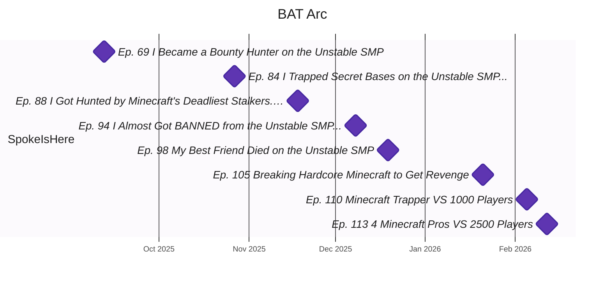

# BAT Arc

<figure class="uu-figure uu-wide" markdown="span">
  { .uu-fig-thumb loading=lazy referrerpolicy=no-referrer }
  <figcaption markdown>Thumbnail of [Ep. 69: I Became a Bounty Hunter on the Unstable SMP](../episodes/season-2/069-i-became-a-bounty-hunter-on-the-unstable-smp.md), the arc’s first episode</figcaption>
</figure>

| Appears in | 8 episodes |
|---|---|
| First seen | [Ep. 69](../episodes/season-2/069-i-became-a-bounty-hunter-on-the-unstable-smp.md) (12 Sep 2025) |
| Latest | [Ep. 113](../episodes/season-2/113-4-minecraft-pros-vs-2500-players.md) (12 Feb 2026) |
| Wiki | [:material-book-open-page-variant: Unstable Universe Wiki](https://unstable-universe-mc.fandom.com/wiki/Arcs) |

[SpokeIsHere](../characters/spokeishere.md) is pressed into [Leow0ok](../characters/leow0ok.md)'s [Bounty Assassin Team](../factions/bounty-assassin-team.md), runs a double life, and ends up at war with BAT and LAW, a conflict that ends with Leo's death in the war against LAW.

## Episodes

- [I Became a Bounty Hunter on the Unstable SMP](../episodes/season-2/069-i-became-a-bounty-hunter-on-the-unstable-smp.md) (ep. 69, SpokeIsHere, 12 September 2025)
- [I Trapped Secret Bases on the Unstable SMP...](../episodes/season-2/084-i-trapped-secret-bases-on-the-unstable-smp.md) (ep. 84, SpokeIsHere, 27 October 2025)
- [I Got Hunted by Minecraft's Deadliest Stalkers...](../episodes/season-2/088-i-got-hunted-by-minecrafts-deadliest-stalkers.md) (ep. 88, SpokeIsHere, 18 November 2025)
- [I Almost Got BANNED from the Unstable SMP...](../episodes/season-2/094-i-almost-got-banned-from-the-unstable-smp.md) (ep. 94, SpokeIsHere, 8 December 2025)
- [My Best Friend Died on the Unstable SMP](../episodes/season-2/098-my-best-friend-died-on-the-unstable-smp.md) (ep. 98, SpokeIsHere, 19 December 2025)
- [Breaking Hardcore Minecraft to Get Revenge](../episodes/season-2/105-breaking-hardcore-minecraft-to-get-revenge.md) (ep. 105, SpokeIsHere, 21 January 2026)
- [Minecraft Trapper VS 1000 Players](../episodes/season-2/110-minecraft-trapper-vs-1000-players.md) (ep. 110, SpokeIsHere, 5 February 2026)
- [4 Minecraft Pros VS 2500 Players](../episodes/season-2/113-4-minecraft-pros-vs-2500-players.md) (ep. 113, SpokeIsHere, 12 February 2026)

## Events in this arc

- [The Orbital Strike Cannon War](../events/the-orbital-strike-cannon-war.md)
- [The LAW Prison](../events/the-law-prison.md)
- [The War Against LAW](../events/the-war-against-law.md)
