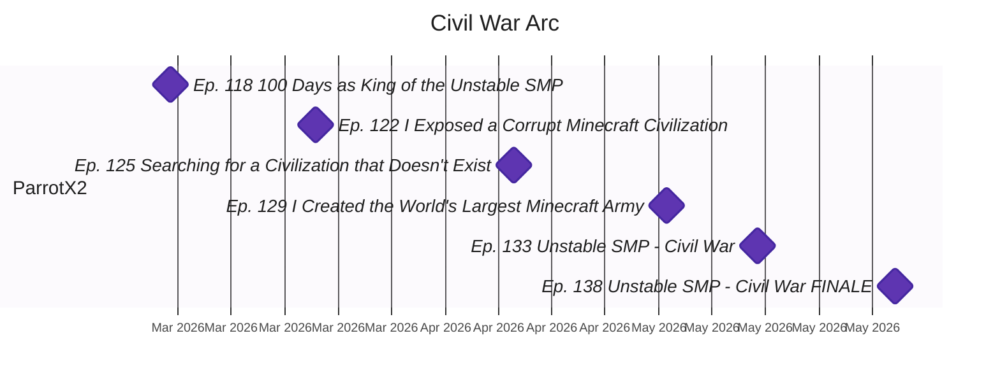

# Civil War Arc

<figure class="uu-figure uu-wide" markdown="span">
  { .uu-fig-thumb loading=lazy referrerpolicy=no-referrer }
  <figcaption markdown>Thumbnail of [Ep. 118: 100 Days as King of the Unstable SMP](../episodes/season-2-plus/118-100-days-as-king-of-the-unstable-smp.md), the arc’s first episode</figcaption>
</figure>

| Appears in | 6 episodes |
|---|---|
| First seen | [Ep. 118](../episodes/season-2-plus/118-100-days-as-king-of-the-unstable-smp.md) (28 Feb 2026) |
| Latest | [Ep. 138](../episodes/season-2-plus/138-unstable-smp-civil-war-finale.md) (3 Jun 2026) |
| Wiki | [:material-book-open-page-variant: Unstable Universe Wiki](https://unstable-universe-mc.fandom.com/wiki/Arcs) |

[ParrotX2](../characters/parrotx2.md)'s reign as king: saving spawn, clearing his name, the loss of [Skymore Civilization](../places/skymore-civilization.md), building the largest army ever, and losing the civil war, and his crown, to [Saparata](../characters/saparata.md)'s [Cindercrest](../factions/cindercrest.md).

## Episodes

- [100 Days as King of the Unstable SMP](../episodes/season-2-plus/118-100-days-as-king-of-the-unstable-smp.md) (ep. 118, ParrotX2, 28 February 2026)
- [I Exposed a Corrupt Minecraft Civilization](../episodes/season-2-plus/122-i-exposed-a-corrupt-minecraft-civilization.md) (ep. 122, ParrotX2, 19 March 2026)
- [Searching for a Civilization that Doesn't Exist](../episodes/season-2-plus/125-searching-for-a-civilization-that-doesnt-exist.md) (ep. 125, ParrotX2, 14 April 2026)
- [I Created the World's Largest Minecraft Army](../episodes/season-2-plus/129-i-created-the-worlds-largest-minecraft-army.md) (ep. 129, ParrotX2, 4 May 2026)
- [Unstable SMP: Civil War](../episodes/season-2-plus/133-unstable-smp-civil-war.md) (ep. 133, ParrotX2, 16 May 2026)
- [Unstable SMP: Civil War FINALE](../episodes/season-2-plus/138-unstable-smp-civil-war-finale.md) (ep. 138, ParrotX2, 3 June 2026)

## Events in this arc

- [The Civil War](../events/the-civil-war.md)
