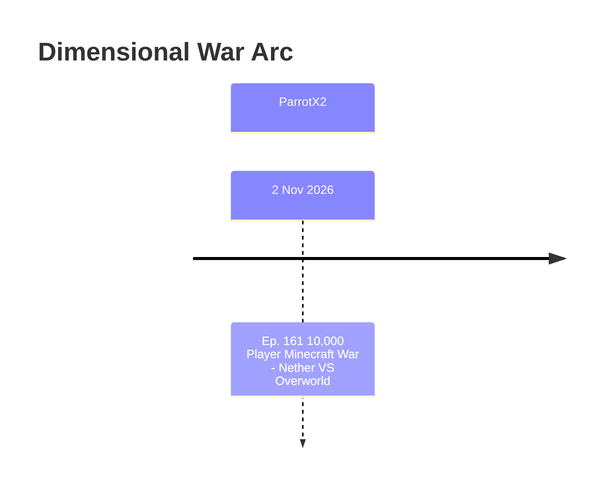

# Dimensional War Arc

<figure class="uu-figure uu-wide" markdown="span">
  { .uu-fig-thumb loading=lazy referrerpolicy=no-referrer }
  <figcaption markdown>Thumbnail of [Ep. 161: 10,000 Player Minecraft War: Nether VS Overworld](../episodes/season-2-plus/161-10-000-player-minecraft-war-nether-vs-overworld.md), the arc’s first episode</figcaption>
</figure>

| Appears in | 1 episode |
|---|---|
| First seen | [Ep. 161](../episodes/season-2-plus/161-10-000-player-minecraft-war-nether-vs-overworld.md) (2 Nov 2026) |
| Wiki | [:material-book-open-page-variant: Unstable Universe Wiki](https://unstable-universe-mc.fandom.com/wiki/Arcs) |

[ParrotX2](../characters/parrotx2.md) unites the Overworld's kings against the [Nether Kingdom](../factions/nether-kingdom.md)'s invasion.

## Episodes

- [10,000 Player Minecraft War: Nether VS Overworld](../episodes/season-2-plus/161-10-000-player-minecraft-war-nether-vs-overworld.md) (ep. 161, ParrotX2, 2 November 2026)

## Events in this arc

- [The Dimensional War](../events/the-dimensional-war.md)
