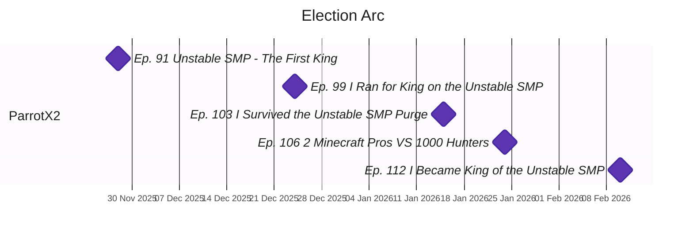

# Election Arc

<figure class="uu-figure uu-wide" markdown="span">
  { .uu-fig-thumb loading=lazy referrerpolicy=no-referrer }
  <figcaption markdown>Thumbnail of [Ep. 91: Unstable SMP: The First King](../episodes/season-2/091-unstable-smp-the-first-king.md), the arc’s first episode</figcaption>
</figure>

| Appears in | 5 episodes |
|---|---|
| First seen | [Ep. 91](../episodes/season-2/091-unstable-smp-the-first-king.md) (28 Nov 2025) |
| Latest | [Ep. 112](../episodes/season-2/112-i-became-king-of-the-unstable-smp.md) (10 Feb 2026) |
| Wiki | [:material-book-open-page-variant: Unstable Universe Wiki](https://unstable-universe-mc.fandom.com/wiki/Arcs) |

[LettuceK](../characters/lettucek.md)'s rigged election for the first king of Unstable. [ParrotX2](../characters/parrotx2.md) climbs from last place through debates, the Purge and an alliance with [Wemmbu](../characters/wemmbu.md), and is crowned king after the war against [LAW](../factions/law.md).

## Episodes

- [Unstable SMP: The First King](../episodes/season-2/091-unstable-smp-the-first-king.md) (ep. 91, ParrotX2, 28 November 2025)
- [I Ran for King on the Unstable SMP](../episodes/season-2/099-i-ran-for-king-on-the-unstable-smp.md) (ep. 99, ParrotX2, 24 December 2025)
- [I Survived the Unstable SMP Purge](../episodes/season-2/103-i-survived-the-unstable-smp-purge.md) (ep. 103, ParrotX2, 15 January 2026)
- [2 Minecraft Pros VS 1000 Hunters](../episodes/season-2/106-2-minecraft-pros-vs-1000-hunters.md) (ep. 106, ParrotX2, 24 January 2026)
- [I Became King of the Unstable SMP](../episodes/season-2/112-i-became-king-of-the-unstable-smp.md) (ep. 112, ParrotX2, 10 February 2026)

## Events in this arc

- [The Election for King](../events/the-election-for-king.md)
- [Parrot Recruits Wemmbu](../events/parrot-recruits-wemmbu.md)
- [The War Against LAW](../events/the-war-against-law.md)
