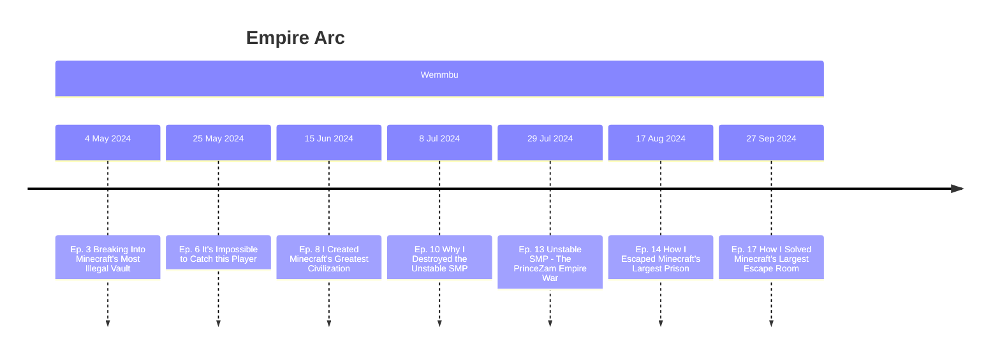

# Empire Arc

<figure class="uu-figure uu-wide" markdown="span">
  { .uu-fig-thumb loading=lazy referrerpolicy=no-referrer }
  <figcaption markdown>Thumbnail of [Ep. 3: Breaking Into Minecraft's Most Illegal Vault](../episodes/season-1/003-breaking-into-minecrafts-most-illegal-vault.md), the arc’s first episode</figcaption>
</figure>

| Appears in | 7 episodes |
|---|---|
| First seen | [Ep. 3](../episodes/season-1/003-breaking-into-minecrafts-most-illegal-vault.md) (4 May 2024) |
| Latest | [Ep. 17](../episodes/season-1/017-how-i-solved-minecrafts-largest-escape-room.md) (27 Sep 2024) |
| Wiki | [:material-book-open-page-variant: Unstable Universe Wiki](https://unstable-universe-mc.fandom.com/wiki/Arcs) |

[Wemmbu](../characters/wemmbu.md)'s Season 1 arc. Allied with [PrinceZam](../characters/princezam.md), he hunts Spoke until Spoke takes a chunk ban, then builds a colony for the [Zam Empire](../places/zam-empire.md), is betrayed, goes to war with it, and ends up imprisoned in [Proton](../places/proton.md) by [ClownPierce](../characters/clownpierce.md).

## Episodes

- [Breaking Into Minecraft's Most Illegal Vault](../episodes/season-1/003-breaking-into-minecrafts-most-illegal-vault.md) (ep. 3, Wemmbu, 4 May 2024)
- [It's Impossible to Catch this Player](../episodes/season-1/006-its-impossible-to-catch-this-player.md) (ep. 6, Wemmbu, 25 May 2024)
- [I Created Minecraft's Greatest Civilization](../episodes/season-1/008-i-created-minecrafts-greatest-civilization.md) (ep. 8, Wemmbu, 15 June 2024)
- [Why I Destroyed the Unstable SMP](../episodes/season-1/010-why-i-destroyed-the-unstable-smp.md) (ep. 10, Wemmbu, 8 July 2024)
- [Unstable SMP: The PrinceZam Empire War](../episodes/season-1/013-unstable-smp-the-princezam-empire-war.md) (ep. 13, Wemmbu, 29 July 2024)
- [How I Escaped Minecraft's Largest Prison](../episodes/season-1/014-how-i-escaped-minecrafts-largest-prison.md) (ep. 14, Wemmbu, 17 August 2024)
- [How I Solved Minecraft's Largest Escape Room](../episodes/season-1/017-how-i-solved-minecrafts-largest-escape-room.md) (ep. 17, Wemmbu, 27 September 2024)

## Events in this arc

- [Spoke's Scavenger Hunt and Chunk Ban](../events/spokes-scavenger-hunt-and-chunk-ban.md)
- [Imprisonment in Proton](../events/imprisonment-in-proton.md)
