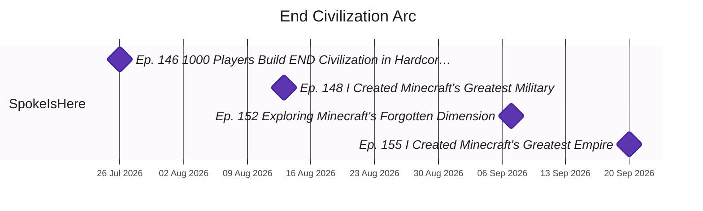

# End Civilization Arc

<figure class="uu-figure uu-wide" markdown="span">
  { .uu-fig-thumb loading=lazy referrerpolicy=no-referrer }
  <figcaption markdown>Thumbnail of [Ep. 146: 1000 Players Build END Civilization in Hardcore Minecraft](../episodes/season-2-plus/146-1000-players-build-end-civilization-in-hardcore-minecraft.md), the arc’s first episode</figcaption>
</figure>

| Appears in | 4 episodes |
|---|---|
| First seen | [Ep. 146](../episodes/season-2-plus/146-1000-players-build-end-civilization-in-hardcore-minecraft.md) (26 Jul 2026) |
| Latest | [Ep. 155](../episodes/season-2-plus/155-i-created-minecrafts-greatest-empire.md) (20 Sep 2026) |
| Wiki | [:material-book-open-page-variant: Unstable Universe Wiki](https://unstable-universe-mc.fandom.com/wiki/Arcs) |

[SpokeIsHere](../characters/spokeishere.md) uses [NULL](../factions/null.md) to conquer the End and build the [End Empire](../places/end-empire.md), overthrowing [MinuteTech](../characters/minutetech.md), hunting [Wemmbu](../characters/wemmbu.md) for his cannons, and leaving [Mapicc](../characters/mapicc.md) in [The Underworld](../places/the-underworld.md).

## Episodes

- [1000 Players Build END Civilization in Hardcore Minecraft](../episodes/season-2-plus/146-1000-players-build-end-civilization-in-hardcore-minecraft.md) (ep. 146, SpokeIsHere, 26 July 2026)
- [I Created Minecraft's Greatest Military](../episodes/season-2-plus/148-i-created-minecrafts-greatest-military.md) (ep. 148, SpokeIsHere, 13 August 2026)
- [Exploring Minecraft's Forgotten Dimension](../episodes/season-2-plus/152-exploring-minecrafts-forgotten-dimension.md) (ep. 152, SpokeIsHere, 7 September 2026)
- [I Created Minecraft's Greatest Empire](../episodes/season-2-plus/155-i-created-minecrafts-greatest-empire.md) (ep. 155, SpokeIsHere, 20 September 2026)

## Events in this arc

- [NULL's Conquest of the End](../events/nulls-conquest-of-the-end.md)
- [Trapped in the Underworld](../events/trapped-in-the-underworld.md)
