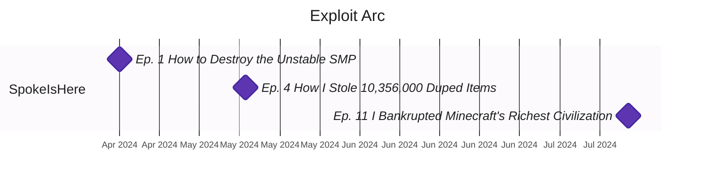

# Exploit Arc

<figure class="uu-figure uu-wide" markdown="span">
  { .uu-fig-thumb loading=lazy referrerpolicy=no-referrer }
  <figcaption markdown>Thumbnail of [Ep. 1: How to Destroy the Unstable SMP](../episodes/season-1/001-how-to-destroy-the-unstable-smp.md), the arc’s first episode</figcaption>
</figure>

| Appears in | 3 episodes |
|---|---|
| First seen | [Ep. 1](../episodes/season-1/001-how-to-destroy-the-unstable-smp.md) (21 Apr 2024) |
| Latest | [Ep. 11](../episodes/season-1/011-i-bankrupted-minecrafts-richest-civilization.md) (19 Jul 2024) |
| Wiki | [:material-book-open-page-variant: Unstable Universe Wiki](https://unstable-universe-mc.fandom.com/wiki/Arcs) |

[SpokeIsHere](../characters/spokeishere.md)'s opening arc. Spoke discovers impossible exploits and illegal items, destroys [The Wonders](../places/the-wonders.md) to cover his tracks, and goes after the duped-item stashes, which leads him to the first signs of [The Invisible Mafia](../factions/the-invisible-mafia.md).

## Episodes

- [How to Destroy the Unstable SMP](../episodes/season-1/001-how-to-destroy-the-unstable-smp.md) (ep. 1, SpokeIsHere, 21 April 2024)
- [How I Stole 10,356,000 Duped Items](../episodes/season-1/004-how-i-stole-10-356-000-duped-items.md) (ep. 4, SpokeIsHere, 13 May 2024)
- [I Bankrupted Minecraft's Richest Civilization](../episodes/season-1/011-i-bankrupted-minecrafts-richest-civilization.md) (ep. 11, SpokeIsHere, 19 July 2024)

## Events in this arc

- [Destruction of the Wonders](../events/destruction-of-the-wonders.md)
