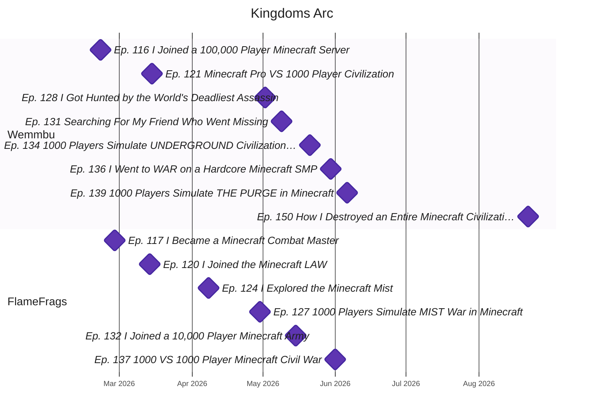

# Kingdoms Arc

<figure class="uu-figure uu-wide" markdown="span">
  { .uu-fig-thumb loading=lazy referrerpolicy=no-referrer }
  <figcaption markdown>Thumbnail of [Ep. 116: I Joined a 100,000 Player Minecraft Server](../episodes/season-2-plus/116-i-joined-a-100-000-player-minecraft-server.md), the arc’s first episode</figcaption>
</figure>

| Appears in | 14 episodes |
|---|---|
| First seen | [Ep. 116](../episodes/season-2-plus/116-i-joined-a-100-000-player-minecraft-server.md) (21 Feb 2026) |
| Latest | [Ep. 150](../episodes/season-2-plus/150-how-i-destroyed-an-entire-minecraft-civilization.md) (22 Aug 2026) |
| Wiki | [:material-book-open-page-variant: Unstable Universe Wiki](https://unstable-universe-mc.fandom.com/wiki/Arcs) |

The Season 2+ saga of [Wemmbu](../characters/wemmbu.md) and [FlameFrags](../characters/flamefrags.md): Wemmbu's struggle against [Arachn1d](../characters/arachn1d.md)'s [Kingdom of the Caves](../factions/kingdom-of-the-caves.md) to free [Eggchan](../characters/eggchan.md), and Flame's road from LAW's errand runner through the Mist to Cindercrest's side of the civil war.

## Episodes

### [Wemmbu](../characters/wemmbu.md)

- [I Joined a 100,000 Player Minecraft Server](../episodes/season-2-plus/116-i-joined-a-100-000-player-minecraft-server.md) (ep. 116, 21 February 2026)
- [Minecraft Pro VS 1000 Player Civilization](../episodes/season-2-plus/121-minecraft-pro-vs-1000-player-civilization.md) (ep. 121, 15 March 2026)
- [I Got Hunted by the World's Deadliest Assassin](../episodes/season-2-plus/128-i-got-hunted-by-the-worlds-deadliest-assassin.md) (ep. 128, 2 May 2026)
- [Searching For My Friend Who Went Missing](../episodes/season-2-plus/131-searching-for-my-friend-who-went-missing.md) (ep. 131, 9 May 2026)
- [1000 Players Simulate UNDERGROUND Civilization in Minecraft](../episodes/season-2-plus/134-1000-players-simulate-underground-civilization-in-minecraft.md) (ep. 134, 21 May 2026)
- [I Went to WAR on a Hardcore Minecraft SMP](../episodes/season-2-plus/136-i-went-to-war-on-a-hardcore-minecraft-smp.md) (ep. 136, 30 May 2026)
- [1000 Players Simulate THE PURGE in Minecraft](../episodes/season-2-plus/139-1000-players-simulate-the-purge-in-minecraft.md) (ep. 139, 6 June 2026)
- [How I Destroyed an Entire Minecraft Civilization](../episodes/season-2-plus/150-how-i-destroyed-an-entire-minecraft-civilization.md) (ep. 150, 22 August 2026)

### [FlameFrags](../characters/flamefrags.md)

- [I Became a Minecraft Combat Master](../episodes/season-2-plus/117-i-became-a-minecraft-combat-master.md) (ep. 117, 27 February 2026)
- [I Joined the Minecraft LAW](../episodes/season-2-plus/120-i-joined-the-minecraft-law.md) (ep. 120, 14 March 2026)
- [I Explored the Minecraft Mist](../episodes/season-2-plus/124-i-explored-the-minecraft-mist.md) (ep. 124, 8 April 2026)
- [1000 Players Simulate MIST War in Minecraft](../episodes/season-2-plus/127-1000-players-simulate-mist-war-in-minecraft.md) (ep. 127, 30 April 2026)
- [I Joined a 10,000 Player Minecraft Army](../episodes/season-2-plus/132-i-joined-a-10-000-player-minecraft-army.md) (ep. 132, 15 May 2026)
- [1000 VS 1000 Player Minecraft Civil War](../episodes/season-2-plus/137-1000-vs-1000-player-minecraft-civil-war.md) (ep. 137, 1 June 2026)

## Events in this arc

- [The Civil War](../events/the-civil-war.md)
- [The Purge of the Caves](../events/the-purge-of-the-caves.md)
