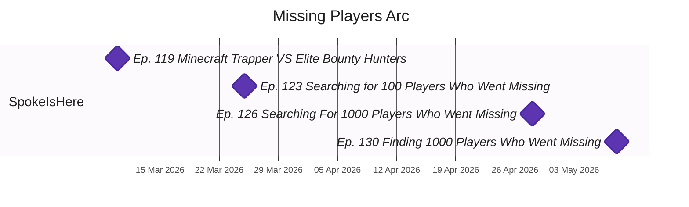

# Missing Players Arc

<figure class="uu-figure uu-wide" markdown="span">
  { .uu-fig-thumb loading=lazy referrerpolicy=no-referrer }
  <figcaption markdown>Thumbnail of [Ep. 119: Minecraft Trapper VS Elite Bounty Hunters](../episodes/season-2-plus/119-minecraft-trapper-vs-elite-bounty-hunters.md), the arc’s first episode</figcaption>
</figure>

| Appears in | 4 episodes |
|---|---|
| First seen | [Ep. 119](../episodes/season-2-plus/119-minecraft-trapper-vs-elite-bounty-hunters.md) (10 Mar 2026) |
| Latest | [Ep. 130](../episodes/season-2-plus/130-finding-1000-players-who-went-missing.md) (8 May 2026) |
| Wiki | [:material-book-open-page-variant: Unstable Universe Wiki](https://unstable-universe-mc.fandom.com/wiki/Arcs) |

[SpokeIsHere](../characters/spokeishere.md) and [JumperWho](../characters/jumperwho.md) search for thousands of vanished players and the missing [Mapicc](../characters/mapicc.md), follow [NULL](../factions/null.md)'s trail to the [Far Lands](../places/far-lands.md), and discover that [JamatoP](../characters/jamatop.md) is behind NULL.

## Episodes

- [Minecraft Trapper VS Elite Bounty Hunters](../episodes/season-2-plus/119-minecraft-trapper-vs-elite-bounty-hunters.md) (ep. 119, SpokeIsHere, 10 March 2026)
- [Searching for 100 Players Who Went Missing](../episodes/season-2-plus/123-searching-for-100-players-who-went-missing.md) (ep. 123, SpokeIsHere, 25 March 2026)
- [Searching For 1000 Players Who Went Missing](../episodes/season-2-plus/126-searching-for-1000-players-who-went-missing.md) (ep. 126, SpokeIsHere, 28 April 2026)
- [Finding 1000 Players Who Went Missing](../episodes/season-2-plus/130-finding-1000-players-who-went-missing.md) (ep. 130, SpokeIsHere, 8 May 2026)
