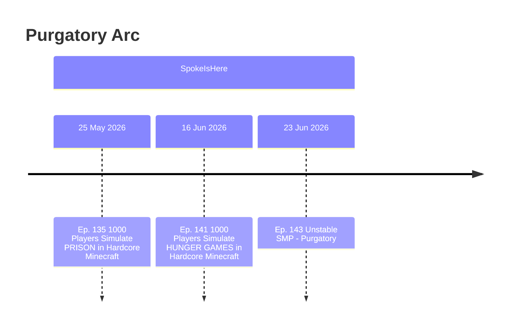

# Purgatory Arc

<figure class="uu-figure uu-wide" markdown="span">
  { .uu-fig-thumb loading=lazy referrerpolicy=no-referrer }
  <figcaption markdown>Thumbnail of [Ep. 135: 1000 Players Simulate PRISON in Hardcore Minecraft](../episodes/season-2-plus/135-1000-players-simulate-prison-in-hardcore-minecraft.md), the arc’s first episode</figcaption>
</figure>

| Appears in | 3 episodes |
|---|---|
| First seen | [Ep. 135](../episodes/season-2-plus/135-1000-players-simulate-prison-in-hardcore-minecraft.md) (25 May 2026) |
| Latest | [Ep. 143](../episodes/season-2-plus/143-unstable-smp-purgatory.md) (23 Jun 2026) |
| Wiki | [:material-book-open-page-variant: Unstable Universe Wiki](https://unstable-universe-mc.fandom.com/wiki/Arcs) |

Imprisoned in [Purgatory](../places/purgatory.md), [SpokeIsHere](../characters/spokeishere.md) survives Jamato's hunger games, frees the prisoners, and wins the Totem of NULL to become NULL's leader.

## Episodes

- [1000 Players Simulate PRISON in Hardcore Minecraft](../episodes/season-2-plus/135-1000-players-simulate-prison-in-hardcore-minecraft.md) (ep. 135, SpokeIsHere, 25 May 2026)
- [1000 Players Simulate HUNGER GAMES in Hardcore Minecraft](../episodes/season-2-plus/141-1000-players-simulate-hunger-games-in-hardcore-minecraft.md) (ep. 141, SpokeIsHere, 16 June 2026)
- [Unstable SMP: Purgatory](../episodes/season-2-plus/143-unstable-smp-purgatory.md) (ep. 143, SpokeIsHere, 23 June 2026)
