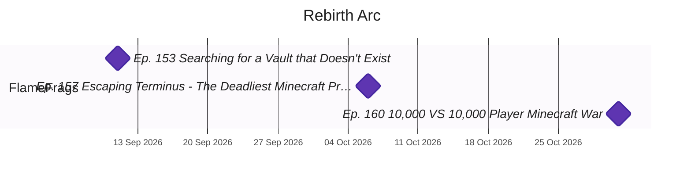

# Rebirth Arc

<figure class="uu-figure uu-wide" markdown="span">
  { .uu-fig-thumb loading=lazy referrerpolicy=no-referrer }
  <figcaption markdown>Thumbnail of [Ep. 153: Searching for a Vault that Doesn't Exist](../episodes/season-2-plus/153-searching-for-a-vault-that-doesnt-exist.md), the arc’s first episode</figcaption>
</figure>

| Appears in | 3 episodes |
|---|---|
| First seen | [Ep. 153](../episodes/season-2-plus/153-searching-for-a-vault-that-doesnt-exist.md) (11 Sep 2026) |
| Latest | [Ep. 160](../episodes/season-2-plus/160-10-000-vs-10-000-player-minecraft-war.md) (31 Oct 2026) |
| Wiki | [:material-book-open-page-variant: Unstable Universe Wiki](https://unstable-universe-mc.fandom.com/wiki/Arcs) |

[FlameFrags](../characters/flamefrags.md) is lured into [Terminus](../places/terminus.md), escapes with LAW's help, turns on [Cindercrest](../factions/cindercrest.md), and becomes LAW's new leader.

## Episodes

- [Searching for a Vault that Doesn't Exist](../episodes/season-2-plus/153-searching-for-a-vault-that-doesnt-exist.md) (ep. 153, FlameFrags, 11 September 2026)
- [Escaping Terminus: The Deadliest Minecraft Prison](../episodes/season-2-plus/157-escaping-terminus-the-deadliest-minecraft-prison.md) (ep. 157, FlameFrags, 6 October 2026)
- [10,000 VS 10,000 Player Minecraft War](../episodes/season-2-plus/160-10-000-vs-10-000-player-minecraft-war.md) (ep. 160, FlameFrags, 31 October 2026)

## Events in this arc

- [The Dimensional War](../events/the-dimensional-war.md)
