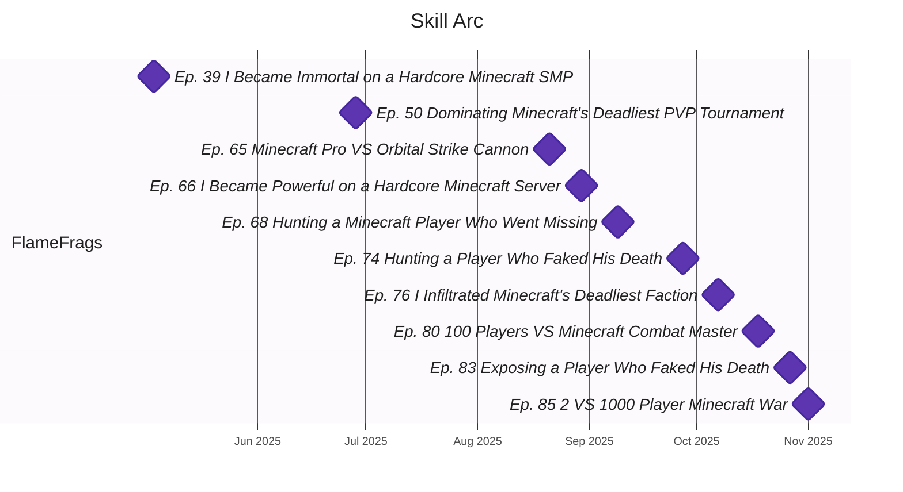

# Skill Arc

<figure class="uu-figure uu-wide" markdown="span">
  { .uu-fig-thumb loading=lazy referrerpolicy=no-referrer }
  <figcaption markdown>Thumbnail of [Ep. 39: I Became Immortal on a Hardcore Minecraft SMP](../episodes/season-2/039-i-became-immortal-on-a-hardcore-minecraft-smp.md), the arc’s first episode</figcaption>
</figure>

| Appears in | 10 episodes |
|---|---|
| First seen | [Ep. 39](../episodes/season-2/039-i-became-immortal-on-a-hardcore-minecraft-smp.md) (3 May 2025) |
| Latest | [Ep. 85](../episodes/season-2/085-2-vs-1000-player-minecraft-war.md) (1 Nov 2025) |
| Wiki | [:material-book-open-page-variant: Unstable Universe Wiki](https://unstable-universe-mc.fandom.com/wiki/Arcs) |

[FlameFrags](../characters/flamefrags.md)' quest to prove he's the strongest: rebuilding his gear, winning the tournament, losing his title to Wemmbu's cannons, and investigating Wemmbu's faked death, all the way to the 2v1000.

## Episodes

- [I Became Immortal on a Hardcore Minecraft SMP](../episodes/season-2/039-i-became-immortal-on-a-hardcore-minecraft-smp.md) (ep. 39, FlameFrags, 3 May 2025)
- [Dominating Minecraft's Deadliest PVP Tournament](../episodes/season-2/050-dominating-minecrafts-deadliest-pvp-tournament.md) (ep. 50, FlameFrags, 28 June 2025)
- [Minecraft Pro VS Orbital Strike Cannon](../episodes/season-2/065-minecraft-pro-vs-orbital-strike-cannon.md) (ep. 65, FlameFrags, 21 August 2025)
- [I Became Powerful on a Hardcore Minecraft Server](../episodes/season-2/066-i-became-powerful-on-a-hardcore-minecraft-server.md) (ep. 66, FlameFrags, 30 August 2025)
- [Hunting a Minecraft Player Who Went Missing](../episodes/season-2/068-hunting-a-minecraft-player-who-went-missing.md) (ep. 68, FlameFrags, 9 September 2025)
- [Hunting a Player Who Faked His Death](../episodes/season-2/074-hunting-a-player-who-faked-his-death.md) (ep. 74, FlameFrags, 27 September 2025)
- [I Infiltrated Minecraft's Deadliest Faction](../episodes/season-2/076-i-infiltrated-minecrafts-deadliest-faction.md) (ep. 76, FlameFrags, 7 October 2025)
- [100 Players VS Minecraft Combat Master](../episodes/season-2/080-100-players-vs-minecraft-combat-master.md) (ep. 80, FlameFrags, 18 October 2025)
- [Exposing a Player Who Faked His Death](../episodes/season-2/083-exposing-a-player-who-faked-his-death.md) (ep. 83, FlameFrags, 27 October 2025)
- [2 VS 1000 Player Minecraft War](../episodes/season-2/085-2-vs-1000-player-minecraft-war.md) (ep. 85, FlameFrags, 1 November 2025)

## Events in this arc

- [Wemmbu and FlameFrags' Rematch](../events/wemmbu-and-flamefrags-rematch.md)
- [The PvP Tournament](../events/the-pvp-tournament.md)
- [The Orbital Strike Cannon War](../events/the-orbital-strike-cannon-war.md)
- [Wemmbu's Fake Death](../events/wemmbus-fake-death.md)
- [Raid on Clown's Nether Vault](../events/raid-on-clowns-nether-vault.md)
- [The 2 VS 1000 War](../events/the-2-vs-1000-war.md)
