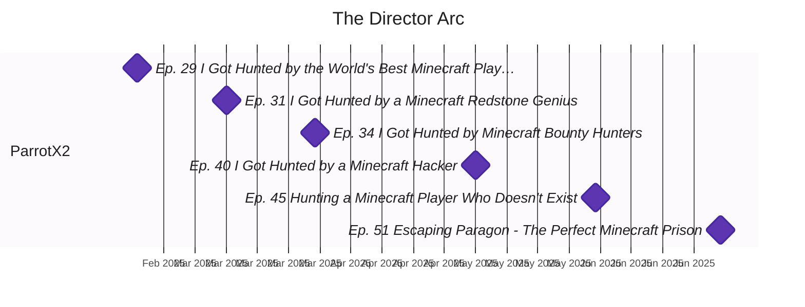

# The Director Arc

<figure class="uu-figure uu-wide" markdown="span">
  { .uu-fig-thumb loading=lazy referrerpolicy=no-referrer }
  <figcaption markdown>Thumbnail of [Ep. 29: I Got Hunted by the World's Best Minecraft Player](../episodes/season-2/029-i-got-hunted-by-the-worlds-best-minecraft-player.md), the arc’s first episode</figcaption>
</figure>

| Appears in | 6 episodes |
|---|---|
| First seen | [Ep. 29](../episodes/season-2/029-i-got-hunted-by-the-worlds-best-minecraft-player.md) (17 Feb 2025) |
| Latest | [Ep. 51](../episodes/season-2/051-escaping-paragon-the-perfect-minecraft-prison.md) (28 Jun 2025) |
| Wiki | [:material-book-open-page-variant: Unstable Universe Wiki](https://unstable-universe-mc.fandom.com/wiki/Arcs) |

[ParrotX2](../characters/parrotx2.md)'s Season 2 opener. Hunted by agents of a mysterious "Director" and taken in by the [Bounty Assassin Team](../factions/bounty-assassin-team.md), Parrot is framed, survives, and discovers that the Director is his supposedly dead best friend [Wifies](../characters/wifies.md), before escaping [Paragon](../places/paragon.md).

## Episodes

- [I Got Hunted by the World's Best Minecraft Player](../episodes/season-2/029-i-got-hunted-by-the-worlds-best-minecraft-player.md) (ep. 29, ParrotX2, 17 February 2025)
- [I Got Hunted by a Minecraft Redstone Genius](../episodes/season-2/031-i-got-hunted-by-a-minecraft-redstone-genius.md) (ep. 31, ParrotX2, 9 March 2025)
- [I Got Hunted by Minecraft Bounty Hunters](../episodes/season-2/034-i-got-hunted-by-minecraft-bounty-hunters.md) (ep. 34, ParrotX2, 29 March 2025)
- [I Got Hunted by a Minecraft Hacker](../episodes/season-2/040-i-got-hunted-by-a-minecraft-hacker.md) (ep. 40, ParrotX2, 4 May 2025)
- [Hunting a Minecraft Player Who Doesn't Exist](../episodes/season-2/045-hunting-a-minecraft-player-who-doesnt-exist.md) (ep. 45, ParrotX2, 31 May 2025)
- [Escaping Paragon: The Perfect Minecraft Prison](../episodes/season-2/051-escaping-paragon-the-perfect-minecraft-prison.md) (ep. 51, ParrotX2, 28 June 2025)

## Events in this arc

- [Spoke Haunts BAT's Void Base](../events/spoke-haunts-bats-void-base.md)
