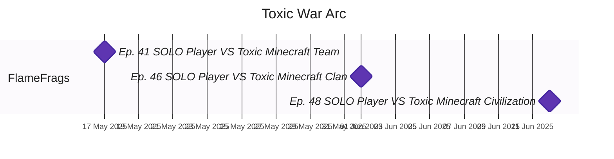

# Toxic War Arc

<figure class="uu-figure uu-wide" markdown="span">
  { .uu-fig-thumb loading=lazy referrerpolicy=no-referrer }
  <figcaption markdown>Thumbnail of [Ep. 41: SOLO Player VS Toxic Minecraft Team](../episodes/season-2/041-solo-player-vs-toxic-minecraft-team.md), the arc’s first episode</figcaption>
</figure>

| Appears in | 3 episodes |
|---|---|
| First seen | [Ep. 41](../episodes/season-2/041-solo-player-vs-toxic-minecraft-team.md) (17 May 2025) |
| Latest | [Ep. 48](../episodes/season-2/048-solo-player-vs-toxic-minecraft-civilization.md) (12 Jun 2025) |
| Wiki | [:material-book-open-page-variant: Unstable Universe Wiki](https://unstable-universe-mc.fandom.com/wiki/Arcs) |

[FlameFrags](../characters/flamefrags.md)' first arc: a one-man war against a toxic clan that killed his pets, ending with the masked VEN0M and the start of his friendship with [Lomedy](../characters/lomedy.md).

## Episodes

- [SOLO Player VS Toxic Minecraft Team](../episodes/season-2/041-solo-player-vs-toxic-minecraft-team.md) (ep. 41, FlameFrags, 17 May 2025)
- [SOLO Player VS Toxic Minecraft Clan](../episodes/season-2/046-solo-player-vs-toxic-minecraft-clan.md) (ep. 46, FlameFrags, 1 June 2025)
- [SOLO Player VS Toxic Minecraft Civilization](../episodes/season-2/048-solo-player-vs-toxic-minecraft-civilization.md) (ep. 48, FlameFrags, 12 June 2025)
