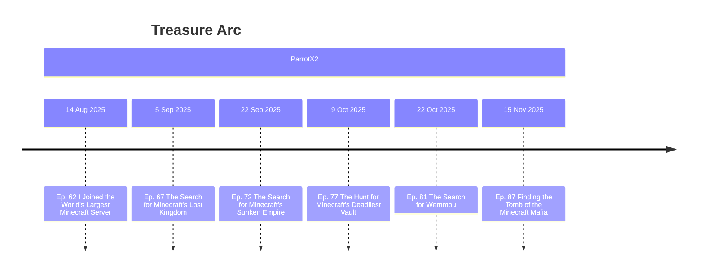

# Treasure Arc

<figure class="uu-figure uu-wide" markdown="span">
  { .uu-fig-thumb loading=lazy referrerpolicy=no-referrer }
  <figcaption markdown>Thumbnail of [Ep. 62: I Joined the World's Largest Minecraft Server](../episodes/season-2/062-i-joined-the-worlds-largest-minecraft-server.md), the arc’s first episode</figcaption>
</figure>

| Appears in | 6 episodes |
|---|---|
| First seen | [Ep. 62](../episodes/season-2/062-i-joined-the-worlds-largest-minecraft-server.md) (14 Aug 2025) |
| Latest | [Ep. 87](../episodes/season-2/087-finding-the-tomb-of-the-minecraft-mafia.md) (15 Nov 2025) |
| Wiki | [:material-book-open-page-variant: Unstable Universe Wiki](https://unstable-universe-mc.fandom.com/wiki/Arcs) |

After [Paragon](../places/paragon.md), [ParrotX2](../characters/parrotx2.md) and [TheobaldTheBird](../characters/theobaldthebird.md) smuggle new players into [Capital City](../places/capital-city.md) and go treasure hunting, for Verdaria, the Sunken Empire, Clown's vault and finally the Mafia's tomb, while helping uncover what happened to [Wemmbu](../characters/wemmbu.md).

## Episodes

- [I Joined the World's Largest Minecraft Server](../episodes/season-2/062-i-joined-the-worlds-largest-minecraft-server.md) (ep. 62, ParrotX2, 14 August 2025)
- [The Search for Minecraft's Lost Kingdom](../episodes/season-2/067-the-search-for-minecrafts-lost-kingdom.md) (ep. 67, ParrotX2, 5 September 2025)
- [The Search for Minecraft's Sunken Empire](../episodes/season-2/072-the-search-for-minecrafts-sunken-empire.md) (ep. 72, ParrotX2, 22 September 2025)
- [The Hunt for Minecraft's Deadliest Vault](../episodes/season-2/077-the-hunt-for-minecrafts-deadliest-vault.md) (ep. 77, ParrotX2, 9 October 2025)
- [The Search for Wemmbu](../episodes/season-2/081-the-search-for-wemmbu.md) (ep. 81, ParrotX2, 22 October 2025)
- [Finding the Tomb of the Minecraft Mafia](../episodes/season-2/087-finding-the-tomb-of-the-minecraft-mafia.md) (ep. 87, ParrotX2, 15 November 2025)

## Events in this arc

- [The Sunken Empire Treasure Hunt](../events/the-sunken-empire-treasure-hunt.md)
- [Raid on Clown's Nether Vault](../events/raid-on-clowns-nether-vault.md)
- [Wemmbu's Fake Death](../events/wemmbus-fake-death.md)
