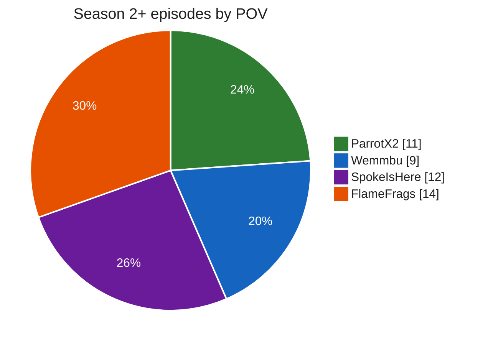
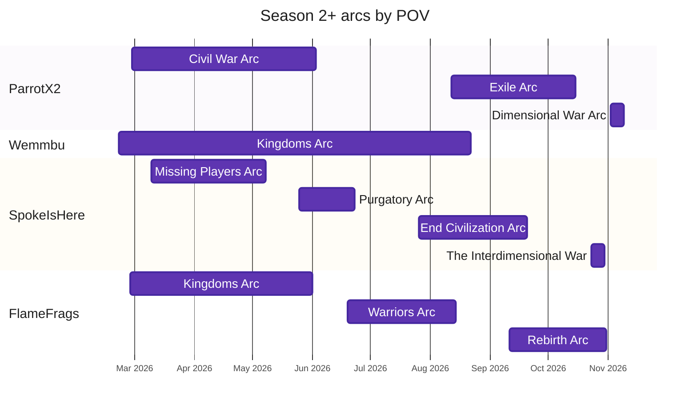

# Season 2+

The episodes since February 2026 (the wiki also calls this Season 3), covering the Kingdoms saga and the civil war, Spoke's Missing Players, Purgatory and End Empire arcs, Flame's Warriors and Rebirth arcs, Parrot's exile, and the Dimensional War.

## At a glance

| Episodes | 46 (ep. 116–161) |
|---|---|
| Uploaded | 21 Feb 2026 – 2 Nov 2026 |
| Arcs | [Kingdoms Arc](../../arcs/kingdoms-arc.md), [Civil War Arc](../../arcs/civil-war-arc.md), [Missing Players Arc](../../arcs/missing-players-arc.md), [Purgatory Arc](../../arcs/purgatory-arc.md), [Warriors Arc](../../arcs/warriors-arc.md), [End Civilization Arc](../../arcs/end-civilization-arc.md), [Exile Arc](../../arcs/exile-arc.md), [Rebirth Arc](../../arcs/rebirth-arc.md), [The Interdimensional War](../../arcs/the-interdimensional-war.md), [Dimensional War Arc](../../arcs/dimensional-war-arc.md) |

## Arcs over time

## Episodes

| Ep. | Episode | POV | Arc | Uploaded |
|---|---|---|---|---|
| 116 | [I Joined a 100,000 Player Minecraft Server](116-i-joined-a-100-000-player-minecraft-server.md) | [Wemmbu](../../characters/wemmbu.md) | [Kingdoms Arc](../../arcs/kingdoms-arc.md) | 2026-02-21 |
| 117 | [I Became a Minecraft Combat Master](117-i-became-a-minecraft-combat-master.md) | [FlameFrags](../../characters/flamefrags.md) | [Kingdoms Arc](../../arcs/kingdoms-arc.md) | 2026-02-27 |
| 118 | [100 Days as King of the Unstable SMP](118-100-days-as-king-of-the-unstable-smp.md) | [ParrotX2](../../characters/parrotx2.md) | [Civil War Arc](../../arcs/civil-war-arc.md) | 2026-02-28 |
| 119 | [Minecraft Trapper VS Elite Bounty Hunters](119-minecraft-trapper-vs-elite-bounty-hunters.md) | [SpokeIsHere](../../characters/spokeishere.md) | [Missing Players Arc](../../arcs/missing-players-arc.md) | 2026-03-10 |
| 120 | [I Joined the Minecraft LAW](120-i-joined-the-minecraft-law.md) | [FlameFrags](../../characters/flamefrags.md) | [Kingdoms Arc](../../arcs/kingdoms-arc.md) | 2026-03-14 |
| 121 | [Minecraft Pro VS 1000 Player Civilization](121-minecraft-pro-vs-1000-player-civilization.md) | [Wemmbu](../../characters/wemmbu.md) | [Kingdoms Arc](../../arcs/kingdoms-arc.md) | 2026-03-15 |
| 122 | [I Exposed a Corrupt Minecraft Civilization](122-i-exposed-a-corrupt-minecraft-civilization.md) | [ParrotX2](../../characters/parrotx2.md) | [Civil War Arc](../../arcs/civil-war-arc.md) | 2026-03-19 |
| 123 | [Searching for 100 Players Who Went Missing](123-searching-for-100-players-who-went-missing.md) | [SpokeIsHere](../../characters/spokeishere.md) | [Missing Players Arc](../../arcs/missing-players-arc.md) | 2026-03-25 |
| 124 | [I Explored the Minecraft Mist](124-i-explored-the-minecraft-mist.md) | [FlameFrags](../../characters/flamefrags.md) | [Kingdoms Arc](../../arcs/kingdoms-arc.md) | 2026-04-08 |
| 125 | [Searching for a Civilization that Doesn't Exist](125-searching-for-a-civilization-that-doesnt-exist.md) | [ParrotX2](../../characters/parrotx2.md) | [Civil War Arc](../../arcs/civil-war-arc.md) | 2026-04-14 |
| 126 | [Searching For 1000 Players Who Went Missing](126-searching-for-1000-players-who-went-missing.md) | [SpokeIsHere](../../characters/spokeishere.md) | [Missing Players Arc](../../arcs/missing-players-arc.md) | 2026-04-28 |
| 127 | [1000 Players Simulate MIST War in Minecraft](127-1000-players-simulate-mist-war-in-minecraft.md) | [FlameFrags](../../characters/flamefrags.md) | [Kingdoms Arc](../../arcs/kingdoms-arc.md) | 2026-04-30 |
| 128 | [I Got Hunted by the World's Deadliest Assassin](128-i-got-hunted-by-the-worlds-deadliest-assassin.md) | [Wemmbu](../../characters/wemmbu.md) | [Kingdoms Arc](../../arcs/kingdoms-arc.md) | 2026-05-02 |
| 129 | [I Created the World's Largest Minecraft Army](129-i-created-the-worlds-largest-minecraft-army.md) | [ParrotX2](../../characters/parrotx2.md) | [Civil War Arc](../../arcs/civil-war-arc.md) | 2026-05-04 |
| 130 | [Finding 1000 Players Who Went Missing](130-finding-1000-players-who-went-missing.md) | [SpokeIsHere](../../characters/spokeishere.md) | [Missing Players Arc](../../arcs/missing-players-arc.md) | 2026-05-08 |
| 131 | [Searching For My Friend Who Went Missing](131-searching-for-my-friend-who-went-missing.md) | [Wemmbu](../../characters/wemmbu.md) | [Kingdoms Arc](../../arcs/kingdoms-arc.md) | 2026-05-09 |
| 132 | [I Joined a 10,000 Player Minecraft Army](132-i-joined-a-10-000-player-minecraft-army.md) | [FlameFrags](../../characters/flamefrags.md) | [Kingdoms Arc](../../arcs/kingdoms-arc.md) | 2026-05-15 |
| 133 | [Unstable SMP: Civil War](133-unstable-smp-civil-war.md) | [ParrotX2](../../characters/parrotx2.md) | [Civil War Arc](../../arcs/civil-war-arc.md) | 2026-05-16 |
| 134 | [1000 Players Simulate UNDERGROUND Civilization in Minecraft](134-1000-players-simulate-underground-civilization-in-minecraft.md) | [Wemmbu](../../characters/wemmbu.md) | [Kingdoms Arc](../../arcs/kingdoms-arc.md) | 2026-05-21 |
| 135 | [1000 Players Simulate PRISON in Hardcore Minecraft](135-1000-players-simulate-prison-in-hardcore-minecraft.md) | [SpokeIsHere](../../characters/spokeishere.md) | [Purgatory Arc](../../arcs/purgatory-arc.md) | 2026-05-25 |
| 136 | [I Went to WAR on a Hardcore Minecraft SMP](136-i-went-to-war-on-a-hardcore-minecraft-smp.md) | [Wemmbu](../../characters/wemmbu.md) | [Kingdoms Arc](../../arcs/kingdoms-arc.md) | 2026-05-30 |
| 137 | [1000 VS 1000 Player Minecraft Civil War](137-1000-vs-1000-player-minecraft-civil-war.md) | [FlameFrags](../../characters/flamefrags.md) | [Kingdoms Arc](../../arcs/kingdoms-arc.md) | 2026-06-01 |
| 138 | [Unstable SMP: Civil War FINALE](138-unstable-smp-civil-war-finale.md) | [ParrotX2](../../characters/parrotx2.md) | [Civil War Arc](../../arcs/civil-war-arc.md) | 2026-06-03 |
| 139 | [1000 Players Simulate THE PURGE in Minecraft](139-1000-players-simulate-the-purge-in-minecraft.md) | [Wemmbu](../../characters/wemmbu.md) | [Kingdoms Arc](../../arcs/kingdoms-arc.md) | 2026-06-06 |
| 140 | [I Became the Strongest on the Unstable SMP](140-i-became-the-strongest-on-the-unstable-smp.md) | [FlameFrags](../../characters/flamefrags.md) |  | 2026-06-09 |
| 141 | [1000 Players Simulate HUNGER GAMES in Hardcore Minecraft](141-1000-players-simulate-hunger-games-in-hardcore-minecraft.md) | [SpokeIsHere](../../characters/spokeishere.md) | [Purgatory Arc](../../arcs/purgatory-arc.md) | 2026-06-16 |
| 142 | [I Got Hunted By the World's Deadliest Minecraft Player](142-i-got-hunted-by-the-worlds-deadliest-minecraft-player.md) | [FlameFrags](../../characters/flamefrags.md) | [Warriors Arc](../../arcs/warriors-arc.md) | 2026-06-19 |
| 143 | [Unstable SMP: Purgatory](143-unstable-smp-purgatory.md) | [SpokeIsHere](../../characters/spokeishere.md) | [Purgatory Arc](../../arcs/purgatory-arc.md) | 2026-06-23 |
| 144 | [I Got Trained By a Minecraft Combat Master](144-i-got-trained-by-a-minecraft-combat-master.md) | [FlameFrags](../../characters/flamefrags.md) | [Warriors Arc](../../arcs/warriors-arc.md) | 2026-07-03 |
| 145 | [Minecraft's Best Players Simulate PVP Tournament](145-minecrafts-best-players-simulate-pvp-tournament.md) | [FlameFrags](../../characters/flamefrags.md) | [Warriors Arc](../../arcs/warriors-arc.md) | 2026-07-21 |
| 146 | [1000 Players Build END Civilization in Hardcore Minecraft](146-1000-players-build-end-civilization-in-hardcore-minecraft.md) | [SpokeIsHere](../../characters/spokeishere.md) | [End Civilization Arc](../../arcs/end-civilization-arc.md) | 2026-07-26 |
| 147 | [I Built Minecraft's Most Advanced Civilization](147-i-built-minecrafts-most-advanced-civilization.md) | [ParrotX2](../../characters/parrotx2.md) | [Exile Arc](../../arcs/exile-arc.md) | 2026-08-12 |
| 148 | [I Created Minecraft's Greatest Military](148-i-created-minecrafts-greatest-military.md) | [SpokeIsHere](../../characters/spokeishere.md) | [End Civilization Arc](../../arcs/end-civilization-arc.md) | 2026-08-13 |
| 149 | [I Exposed Minecraft's "Strongest" Player](149-i-exposed-minecrafts-strongest-player.md) | [FlameFrags](../../characters/flamefrags.md) | [Warriors Arc](../../arcs/warriors-arc.md) | 2026-08-14 |
| 150 | [How I Destroyed an Entire Minecraft Civilization](150-how-i-destroyed-an-entire-minecraft-civilization.md) | [Wemmbu](../../characters/wemmbu.md) | [Kingdoms Arc](../../arcs/kingdoms-arc.md) | 2026-08-22 |
| 151 | [1000 Players Simulate Mining Prison in Minecraft](151-1000-players-simulate-mining-prison-in-minecraft.md) | [ParrotX2](../../characters/parrotx2.md) | [Exile Arc](../../arcs/exile-arc.md) | 2026-09-06 |
| 152 | [Exploring Minecraft's Forgotten Dimension](152-exploring-minecrafts-forgotten-dimension.md) | [SpokeIsHere](../../characters/spokeishere.md) | [End Civilization Arc](../../arcs/end-civilization-arc.md) | 2026-09-07 |
| 153 | [Searching for a Vault that Doesn't Exist](153-searching-for-a-vault-that-doesnt-exist.md) | [FlameFrags](../../characters/flamefrags.md) | [Rebirth Arc](../../arcs/rebirth-arc.md) | 2026-09-11 |
| 154 | [How I Saved the World's Largest Minecraft Server](154-how-i-saved-the-worlds-largest-minecraft-server.md) | [Wemmbu](../../characters/wemmbu.md) |  | 2026-09-19 |
| 155 | [I Created Minecraft's Greatest Empire](155-i-created-minecrafts-greatest-empire.md) | [SpokeIsHere](../../characters/spokeishere.md) | [End Civilization Arc](../../arcs/end-civilization-arc.md) | 2026-09-20 |
| 156 | [Escaping the Minecraft Underworld](156-escaping-the-minecraft-underworld.md) | [ParrotX2](../../characters/parrotx2.md) | [Exile Arc](../../arcs/exile-arc.md) | 2026-09-22 |
| 157 | [Escaping Terminus: The Deadliest Minecraft Prison](157-escaping-terminus-the-deadliest-minecraft-prison.md) | [FlameFrags](../../characters/flamefrags.md) | [Rebirth Arc](../../arcs/rebirth-arc.md) | 2026-10-06 |
| 158 | [1000 Players Simulate End Prison in Minecraft](158-1000-players-simulate-end-prison-in-minecraft.md) | [ParrotX2](../../characters/parrotx2.md) | [Exile Arc](../../arcs/exile-arc.md) | 2026-10-15 |
| 159 | [10,000 Players Simulate COLD WAR in Minecraft](159-10-000-players-simulate-cold-war-in-minecraft.md) | [SpokeIsHere](../../characters/spokeishere.md) | [The Interdimensional War](../../arcs/the-interdimensional-war.md) | 2026-10-23 |
| 160 | [10,000 VS 10,000 Player Minecraft War](160-10-000-vs-10-000-player-minecraft-war.md) | [FlameFrags](../../characters/flamefrags.md) | [Rebirth Arc](../../arcs/rebirth-arc.md) | 2026-10-31 |
| 161 | [10,000 Player Minecraft War: Nether VS Overworld](161-10-000-player-minecraft-war-nether-vs-overworld.md) | [ParrotX2](../../characters/parrotx2.md) | [Dimensional War Arc](../../arcs/dimensional-war-arc.md) | 2026-11-02 |

