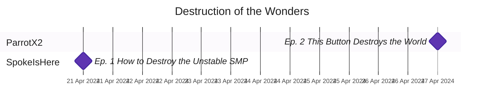

# Destruction of the Wonders

<figure class="uu-figure uu-wide" markdown="span">
  { .uu-fig-thumb loading=lazy referrerpolicy=no-referrer }
  <figcaption markdown>Thumbnail of [Ep. 1: How to Destroy the Unstable SMP](../episodes/season-1/001-how-to-destroy-the-unstable-smp.md), where it starts</figcaption>
</figure>

## Summary

[SpokeIsHere](../characters/spokeishere.md) decides to wipe out [The Wonders](../places/the-wonders.md) with an orbital TNT cannon to bury the evidence of his exploits. [ParrotX2](../characters/parrotx2.md) races to build a cannon of his own to stop him, but both cannons fire at the same moment, and the last Wonder is destroyed.

## Perspectives

### [SpokeIsHere](../characters/spokeishere.md)

Spoke's side: why the Wonders had to go. The exploited items are hidden inside them, so he builds the cannon a million blocks out and fires it with [JamatoP](../characters/jamatop.md).

- [How to Destroy the Unstable SMP](../episodes/season-1/001-how-to-destroy-the-unstable-smp.md) (ep. 1, 21 April 2024)

### [ParrotX2](../characters/parrotx2.md)

Parrot's side: working out who is behind the craters, failing to rally anyone else, and sheltering with the guards in an obsidian bunker as the cannons fire.

- [This Button Destroys the World](../episodes/season-1/002-this-button-destroys-the-world.md) (ep. 2, 27 April 2024)

## Timeline

### [How to Destroy the Unstable SMP](../episodes/season-1/001-how-to-destroy-the-unstable-smp.md) (ep. 1, SpokeIsHere)

The episode that starts it all.

- Jamato abandons the project and leaves Spoke.
- Wemmbu now knows Spoke is hiding something and has fought him twice.
- The first Wonder is destroyed by Spoke's cannon.

### [This Button Destroys the World](../episodes/season-1/002-this-button-destroys-the-world.md) (ep. 2, ParrotX2)

[ParrotX2](../characters/parrotx2.md)'s first episode.

- All of The Wonders are destroyed.
- Parrot has learned to build orbital cannons, and knows Wemmbu and Roshambo are hiding something.

## Aftermath

- The Wonders, and the evidence of Spoke's first exploits inside them, are gone.
- Soon Spoke's dupe glitch floods the server with illegal items, and he spends the [Exploit Arc](../arcs/exploit-arc.md) trying to destroy the stashes.
