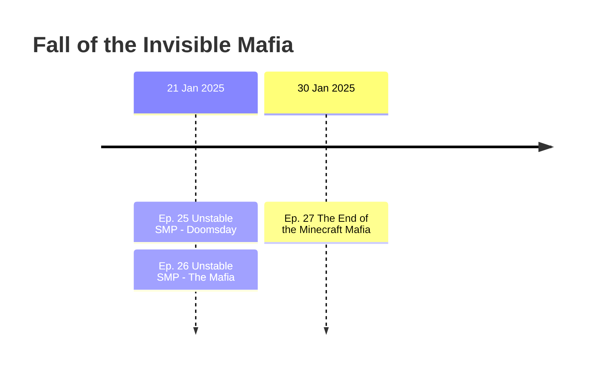

# Fall of the Invisible Mafia

<figure class="uu-figure uu-wide" markdown="span">
  { .uu-fig-thumb loading=lazy referrerpolicy=no-referrer }
  <figcaption markdown>Thumbnail of [Ep. 25: Unstable SMP: Doomsday](../episodes/season-1/025-unstable-smp-doomsday.md), where it starts</figcaption>
</figure>

## Summary

The Season 1 finale, told from three POVs. [ParrotX2](../characters/parrotx2.md)'s [District 13](../factions/district-13.md) unites the protagonists against [The Invisible Mafia](../factions/the-invisible-mafia.md): [Wemmbu](../characters/wemmbu.md) keeps [ClownPierce](../characters/clownpierce.md) busy, Parrot fights the Battle of Stasis and loses [Wifies](../characters/wifies.md), and [SpokeIsHere](../characters/spokeishere.md) reaches the Mafia's stasis chambers in the void and destroys them, ending the Mafia while sparing [Ashswag](../characters/ashswag.md).

## Perspectives

### [ParrotX2](../characters/parrotx2.md)

Parrot's side: building District 13, Horace's defection, the raid on Mafia City, and Wifies' death after the Battle of Stasis.

- [Unstable SMP: Doomsday](../episodes/season-1/025-unstable-smp-doomsday.md) (ep. 25, 21 January 2025)

### [Wemmbu](../characters/wemmbu.md)

Wemmbu's side: the treehouse burning, joining Parrot's plan to win a mace, and keeping Clown and Ferre occupied.

- [Unstable SMP: The Mafia](../episodes/season-1/026-unstable-smp-the-mafia.md) (ep. 26, 21 January 2025)

### [SpokeIsHere](../characters/spokeishere.md)

Spoke's side: warning the hidden civilizations, finding the pearl cannon tunnel, and mining out the stasis pearls before letting Ash go.

- [The End of the Minecraft Mafia](../episodes/season-1/027-the-end-of-the-minecraft-mafia.md) (ep. 27, 30 January 2025)

## Timeline

### [Unstable SMP: Doomsday](../episodes/season-1/025-unstable-smp-doomsday.md) (ep. 25, ParrotX2)

The Season 1 finale from [ParrotX2](../characters/parrotx2.md)'s side.

- Wifies dies, apparently, at Ash's hand (later shown to be faked).
- Horace and many resistance members defect to the Mafia; Yusai is killed by mistake.
- The stasis chambers are found and the Mafia's members unmask; Ash survives.

### [Unstable SMP: The Mafia](../episodes/season-1/026-unstable-smp-the-mafia.md) (ep. 26, Wemmbu)

[ClownPierce](../characters/clownpierce.md) and [FerreMC](../characters/ferremc.md) burn down ManePear's treehouse, and [Wemmbu](../characters/wemmbu.md) vows to kill Clown.

- ManePear's treehouse is destroyed; two gold-trims die to order 36.
- Wemmbu ends the Mafia era with a mace and a grudge against Clown, and his duel is left unfinished.

### [The End of the Minecraft Mafia](../episodes/season-1/027-the-end-of-the-minecraft-mafia.md) (ep. 27, SpokeIsHere)

The end of [The Invisible Mafia](../factions/the-invisible-mafia.md), from [SpokeIsHere](../characters/spokeishere.md)'s side.

- The Invisible Mafia falls; its stasis pearls are destroyed.
- Nico is killed; Squiddo's castle is destroyed.
- Ash is spared and leaves, with a warning about Spoke's future.

## Aftermath

- Season 2 opens on a wrecked [Spawn](../places/spawn.md). WyLL takes over [Mafia City](../places/mafia-city.md), Ashswag hides at Point Nemo, and Clown claims the Nether as his kingdom.
- The protagonists scatter: Wemmbu and Egg try to settle down, Parrot joins the [Bounty Assassin Team](../factions/bounty-assassin-team.md), and Spoke begins his [Secret Base Arc](../arcs/secret-base-arc.md).
