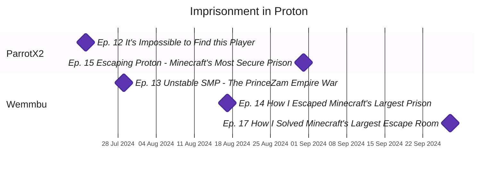

# Imprisonment in Proton

<figure class="uu-figure uu-wide" markdown="span">
  { .uu-fig-thumb loading=lazy referrerpolicy=no-referrer }
  <figcaption markdown>Thumbnail of [Ep. 12: It's Impossible to Find this Player](../episodes/season-1/012-its-impossible-to-find-this-player.md), where it starts</figcaption>
</figure>

## Summary

[ClownPierce](../characters/clownpierce.md) fills his new prison, [Proton](../places/proton.md), with the server's biggest names. [ParrotX2](../characters/parrotx2.md) and [Wifies](../characters/wifies.md) are lured in through a series of quests, and [Wemmbu](../characters/wemmbu.md) and [PrinceZam](../characters/princezam.md) are taken straight after the Empire War. Each POV then shows its own escape.

## Perspectives

### [ParrotX2](../characters/parrotx2.md)

Parrot is led to Proton by the "game masters", loses Wifies to a hidden chunk ban, and organises a mass breakout with the other missing players.

- [It's Impossible to Find this Player](../episodes/season-1/012-its-impossible-to-find-this-player.md) (ep. 12, 22 July 2024)
- [Escaping Proton: Minecraft's Most Secure Prison](../episodes/season-1/015-escaping-proton-minecrafts-most-secure-prison.md) (ep. 15, 31 August 2024)

### [Wemmbu](../characters/wemmbu.md)

Wemmbu is captured with Zam at the end of the war, survives Zam inside the simulated world, and escapes over the walls with an ender pearl cannon.

- [Unstable SMP: The PrinceZam Empire War](../episodes/season-1/013-unstable-smp-the-princezam-empire-war.md) (ep. 13, 29 July 2024)
- [How I Escaped Minecraft's Largest Prison](../episodes/season-1/014-how-i-escaped-minecrafts-largest-prison.md) (ep. 14, 17 August 2024)
- [How I Solved Minecraft's Largest Escape Room](../episodes/season-1/017-how-i-solved-minecrafts-largest-escape-room.md) (ep. 17, 27 September 2024)

## Timeline

### [It's Impossible to Find this Player](../episodes/season-1/012-its-impossible-to-find-this-player.md) (ep. 12, ParrotX2)

[ParrotX2](../characters/parrotx2.md)'s friends [Rekrap2](../characters/rekrap2.md), [JumperWho](../characters/jumperwho.md), [Kenadian](../characters/kenadian.md), [Derapchu](../characters/derapchu.md) and [Leow0ok](../characters/leow0ok.md) have vanished, along with [ClownPierce](../characters/clownpierce.md).

- The Treasure Hunters are robbed of most of their wealth by Parrot, Wifies and Wemmbu.
- Parrot gives up his spyglass as the "last key".
- Parrot and Wifies are taken into Proton by Clown.

### [Unstable SMP: The PrinceZam Empire War](../episodes/season-1/013-unstable-smp-the-princezam-empire-war.md) (ep. 13, Wemmbu)

[Wemmbu](../characters/wemmbu.md) takes the war to [PrinceZam](../characters/princezam.md).

- The Zam Empire is destroyed by the orbital strike.
- Zam's guards are kidnapped and then freed: yungwillx, Peentar and Sorhin.
- Wemmbu and Zam make peace, and both are captured by Clown and taken to Proton.

### [How I Escaped Minecraft's Largest Prison](../episodes/season-1/014-how-i-escaped-minecrafts-largest-prison.md) (ep. 14, Wemmbu)

[ClownPierce](../characters/clownpierce.md) drops [Wemmbu](../characters/wemmbu.md) and [PrinceZam](../characters/princezam.md) into [Proton](../places/proton.md): a roofless obsidian box holding a whole simulated Minecraft world, with three totems each.

- Pangi is chunk banned.
- Zam Empire 2.0 is destroyed.
- Wemmbu escapes Proton alone; Egg, Zam and the others are still inside.

### [Escaping Proton: Minecraft's Most Secure Prison](../episodes/season-1/015-escaping-proton-minecrafts-most-secure-prison.md) (ep. 15, ParrotX2)

Inside [Proton](../places/proton.md), [ParrotX2](../characters/parrotx2.md) loses [Wifies](../characters/wifies.md) to a hidden fox ban almost immediately, then is shuffled between three cells by silent guards.

- Wifies is fox banned, then freed.
- The missing players break out of Proton with help from Wemmbu.
- Proton's guards are fooled in their own control room.

### [How I Solved Minecraft's Largest Escape Room](../episodes/season-1/017-how-i-solved-minecrafts-largest-escape-room.md) (ep. 17, Wemmbu)

Locked together in [ClownPierce](../characters/clownpierce.md)'s giant escape room, built by [Wato1876](../characters/wato1876.md), [Wemmbu](../characters/wemmbu.md) and [PrinceZam](../characters/princezam.md) crawl, craft and launch themselves through room after room of trick puzzles.

- Wemmbu and Zam escape Clown's escape room; Zam makes it out through the portal.
- Wemmbu keeps a mace and a maxed netherite sword and boots, and Clown is now his enemy.

## Aftermath

- Everyone escapes Proton, which is abandoned. Wemmbu crafts a [Mace](../mechanics/mace.md) in Clown's escape room and won't return it until Clown says where Egg is.
- Clown reveals he has destroyed the trial vaults, so the remaining maces are the server's last.
- Tired of being hunted, Parrot and Wifies leave for the End to found [The End Civilization](../places/the-end-civilization.md).
