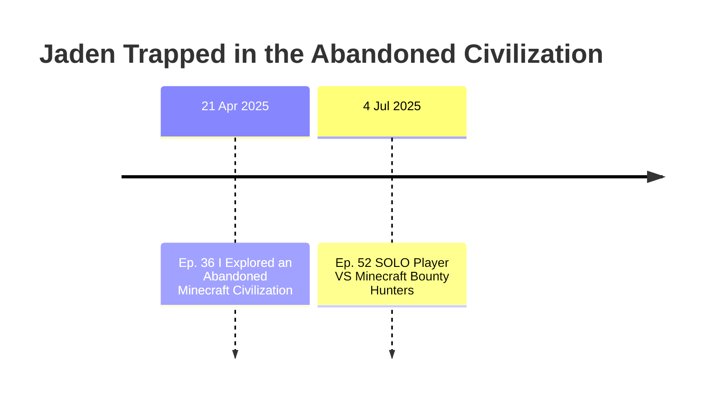

# Jaden Trapped in the Abandoned Civilization

<figure class="uu-figure uu-wide" markdown="span">
  { .uu-fig-thumb loading=lazy referrerpolicy=no-referrer }
  <figcaption markdown>Thumbnail of [Ep. 36: I Explored an Abandoned Minecraft Civilization](../episodes/season-2/036-i-explored-an-abandoned-minecraft-civilization.md), where it starts</figcaption>
</figure>

## Summary

[Wemmbu](../characters/wemmbu.md)'s hunt for [Jaden_MAN](../characters/jaden-man.md) ends with Wemmbu leaving him trapped deep in [The Abandoned Civilization](../places/the-abandoned-civilization.md). Later, Jaden's best friend [FlameFrags](../characters/flamefrags.md) searches for him, finds him, and learns who put him there, which sets up the Betrayal Arc and [The Avengers](../factions/the-avengers.md).

## Perspectives

### [Wemmbu](../characters/wemmbu.md)

Wemmbu's side: chasing Jaden underground, losing Rejoicin to a warden, and walking away with Jaden still trapped.

- [I Explored an Abandoned Minecraft Civilization](../episodes/season-2/036-i-explored-an-abandoned-minecraft-civilization.md) (ep. 36, 21 April 2025)

### [FlameFrags](../characters/flamefrags.md)

Flame's side: following LettuceK's evasions and the LAW meetings to find Jaden, who tells him "It was Wemmbu."

- [SOLO Player VS Minecraft Bounty Hunters](../episodes/season-2/052-solo-player-vs-minecraft-bounty-hunters.md) (ep. 52, 4 July 2025)

## Timeline

### [I Explored an Abandoned Minecraft Civilization](../episodes/season-2/036-i-explored-an-abandoned-minecraft-civilization.md) (ep. 36, Wemmbu)

[Wemmbu](../characters/wemmbu.md) dives into [The Abandoned Civilization](../places/the-abandoned-civilization.md) after [Jaden_MAN](../characters/jaden-man.md), a vast underground ruin full of wardens, with elder guardians giving the whole place mining fatigue.

- Rejoicin is killed by wardens released by Jaden.
- Jaden_MAN is beaten, stripped of his items, and left trapped in the Abandoned Civilization.
- Wemmbu recovers his mace; Loppezz becomes an ally.

### [SOLO Player VS Minecraft Bounty Hunters](../episodes/season-2/052-solo-player-vs-minecraft-bounty-hunters.md) (ep. 52, FlameFrags)

[FlameFrags](../characters/flamefrags.md)' best friend [Jaden_MAN](../characters/jaden-man.md) has vanished, and [LettuceK](../characters/lettucek.md)'s bounty hunters, [LAW](../factions/law.md), know why but won't say.

- Jaden_MAN is found alive in the Abandoned Civilization.
- Flame learns that Wemmbu was the one who trapped Jaden.
- LAW loses several lawmen; Lettuce escapes.

## Aftermath

- Rescued and told who trapped him, Jaden wants revenge; he and Flame form [The Avengers](../factions/the-avengers.md) to hunt Wemmbu ([The Avengers' Hunt for Wemmbu](the-avengers-hunt-for-wemmbu.md)).
