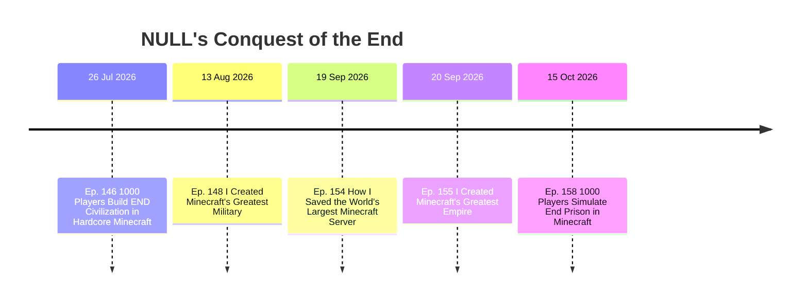

# NULL's Conquest of the End

<figure class="uu-figure uu-wide" markdown="span">
  { .uu-fig-thumb loading=lazy referrerpolicy=no-referrer }
  <figcaption markdown>Thumbnail of [Ep. 146: 1000 Players Build END Civilization in Hardcore Minecraft](../episodes/season-2-plus/146-1000-players-build-end-civilization-in-hardcore-minecraft.md), where it starts</figcaption>
</figure>

## Summary

With the Totem of NULL, [SpokeIsHere](../characters/spokeishere.md) turns [NULL](../factions/null.md) into the [End Empire](../places/end-empire.md). He overthrows the End's guardian [MinuteTech](../characters/minutetech.md), tries to recruit [Wemmbu](../characters/wemmbu.md) for his orbital cannons, and fills an End prison with captives, among them [ParrotX2](../characters/parrotx2.md). The same campaign is seen from inside by Wemmbu, hunted into the Underworld, and by Parrot, fighting through the prison's five floors.

## Perspectives

### [SpokeIsHere](../characters/spokeishere.md)

Spoke's side: building the End civilisation, breaking Cindercrest's spawn trap, wooing and then hunting Wemmbu, and Ashswag's warning.

- [1000 Players Build END Civilization in Hardcore Minecraft](../episodes/season-2-plus/146-1000-players-build-end-civilization-in-hardcore-minecraft.md) (ep. 146, 26 July 2026)
- [I Created Minecraft's Greatest Military](../episodes/season-2-plus/148-i-created-minecrafts-greatest-military.md) (ep. 148, 13 August 2026)
- [I Created Minecraft's Greatest Empire](../episodes/season-2-plus/155-i-created-minecrafts-greatest-empire.md) (ep. 155, 20 September 2026)

### [Wemmbu](../characters/wemmbu.md)

Wemmbu's side: Minute's plea for help, Spoke's ultimatum, Minute's apparent death, and the escape into the Underworld.

- [How I Saved the World's Largest Minecraft Server](../episodes/season-2-plus/154-how-i-saved-the-worlds-largest-minecraft-server.md) (ep. 154, 19 September 2026)

### [ParrotX2](../characters/parrotx2.md)

Parrot's side: the five-floor End prison, finding Minute alive, and confronting the new Spoke.

- [1000 Players Simulate End Prison in Minecraft](../episodes/season-2-plus/158-1000-players-simulate-end-prison-in-minecraft.md) (ep. 158, 15 October 2026)

## Timeline

### [1000 Players Build END Civilization in Hardcore Minecraft](../episodes/season-2-plus/146-1000-players-build-end-civilization-in-hardcore-minecraft.md) (ep. 146, SpokeIsHere)

Now leader of [NULL](../factions/null.md), [SpokeIsHere](../characters/spokeishere.md) invades the End, defeats [MinuteTech](../characters/minutetech.md)'s guardians, and builds the [End Empire](../places/end-empire.md) in its southern quadrant.

- The End's civilizations are wiped out; VoidMoon and MinerMan are killed.
- Jamato escapes with his escort.
- The dragon is respawned and killed, and NULL heads for the Overworld.

### [I Created Minecraft's Greatest Military](../episodes/season-2-plus/148-i-created-minecrafts-greatest-military.md) (ep. 148, SpokeIsHere)

[SpokeIsHere](../characters/spokeishere.md) leads [NULL](../factions/null.md) back into the Overworld to seize every End portal, building a vast Purgatory-like capital.

- NULL captures most of the End portals, but loses six strongholds to unknown invisible attackers.
- Spoke's team dies in the warden trap; the Vael Company is destroyed.
- Jumper breaks with Spoke; Spoke heads for [The Underworld](../places/the-underworld.md) (see [Trapped in the Underworld](trapped-in-the-underworld.md)).

### [How I Saved the World's Largest Minecraft Server](../episodes/season-2-plus/154-how-i-saved-the-worlds-largest-minecraft-server.md) (ep. 154, Wemmbu)

Hunted by King Saparata's bounty during a server-wide famine, [Wemmbu](../characters/wemmbu.md) learns from [MinuteTech](../characters/minutetech.md) that [SpokeIsHere](../characters/spokeishere.md) has conquered the End with [NULL](../factions/null.md).

- Wemmbu's orbital cannons are destroyed.
- Jaden_MAN is killed by Nitenly; MinuteTech is reported dead; the first-generation civilization falls.
- Wemmbu and Egg enter the Underworld in search of the Forge.

### [I Created Minecraft's Greatest Empire](../episodes/season-2-plus/155-i-created-minecrafts-greatest-empire.md) (ep. 155, SpokeIsHere)

The same campaign from [SpokeIsHere](../characters/spokeishere.md)'s side.

- The orbital cannons are destroyed; MinuteTech is captured.
- The Wraiths join NULL.
- Ashswag reappears, urging Spoke to accept what he has become.

### [1000 Players Simulate End Prison in Minecraft](../episodes/season-2-plus/158-1000-players-simulate-end-prison-in-minecraft.md) (ep. 158, ParrotX2)

Captured by [NULL](../factions/null.md), [ParrotX2](../characters/parrotx2.md) wakes in [SpokeIsHere](../characters/spokeishere.md)'s five-floor End prison, where every floor filters out prisoners.

- Parrot clears all five floors and escapes; Minute sends himself back to floor one.
- Parrot learns NULL and Clown's Nether Kingdom both plan to invade the Overworld.
- Parrot breaks with Spoke and refuses to join NULL.

## Aftermath

- MinuteTech is imprisoned, Wemmbu's cannons are destroyed, and Parrot refuses to join NULL. The [Nether Kingdom](../factions/nether-kingdom.md) comes for NULL's capital ([The Dimensional War](the-dimensional-war.md)).
