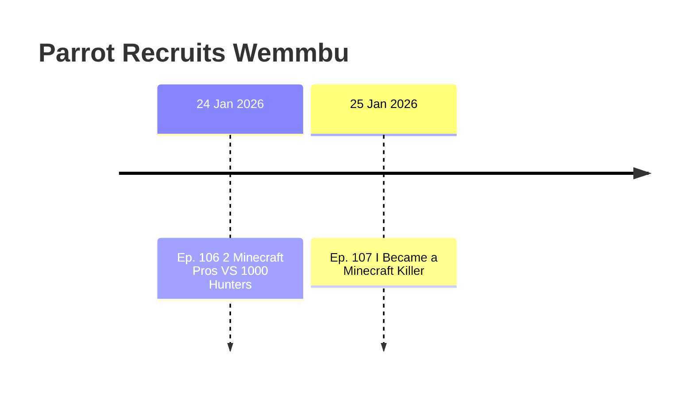

# Parrot Recruits Wemmbu

<figure class="uu-figure uu-wide" markdown="span">
  { .uu-fig-thumb loading=lazy referrerpolicy=no-referrer }
  <figcaption markdown>Thumbnail of [Ep. 106: 2 Minecraft Pros VS 1000 Hunters](../episodes/season-2/106-2-minecraft-pros-vs-1000-hunters.md), where it starts</figcaption>
</figure>

## Summary

To win the election, [ParrotX2](../characters/parrotx2.md) needs [Wemmbu](../characters/wemmbu.md), the man he once exposed. Parrot finds him in the abandoned [Pirate City](../places/pirate-city.md), and the two make a tense run back through [LAW](../factions/law.md) territory by dolphin tunnel, river and happy ghast, while [LettuceK](../characters/lettucek.md) runs the debate without Parrot.

## Perspectives

### [ParrotX2](../characters/parrotx2.md)

Parrot's side: the sixteen-hour journey, pretending to rat Wemmbu out to the lawmen, and the debate he misses.

- [2 Minecraft Pros VS 1000 Hunters](../episodes/season-2/106-2-minecraft-pros-vs-1000-hunters.md) (ep. 106, 24 January 2026)

### [Wemmbu](../characters/wemmbu.md)

Wemmbu's side: no gear, a broken elytra, and deciding to spare Parrot after his tearful apology, then heading back to the Far Lands for his cannons.

- [I Became a Minecraft Killer](../episodes/season-2/107-i-became-a-minecraft-killer.md) (ep. 107, 25 January 2026)

## Timeline

### [2 Minecraft Pros VS 1000 Hunters](../episodes/season-2/106-2-minecraft-pros-vs-1000-hunters.md) (ep. 106, ParrotX2)

To expose [LettuceK](../characters/lettucek.md) at the final debate, [ParrotX2](../characters/parrotx2.md) travels to [The Great Sea](../places/the-great-sea.md) and persuades the escaped [Wemmbu](../characters/wemmbu.md) to come back with him.

- Wemmbu's escape is proven publicly at the debate.
- The_Oroboros is killed by Theo, who is then captured by LAW.
- Lettuce suspends the election and demands Parrot's surrender.

### [I Became a Minecraft Killer](../episodes/season-2/107-i-became-a-minecraft-killer.md) (ep. 107, Wemmbu)

The same journey from [Wemmbu](../characters/wemmbu.md)'s side.

- Wemmbu spares Parrot and helps expose Lettuce.
- Egg is revealed to have joined LAW undercover.
- Wemmbu heads to the Far Lands to restore his strength.

## Aftermath

- Wemmbu's journey goes on to the Far Lands, where a pearl cannon drops him at JamatoP's house and he recovers his orbital cannons (eps. 108–111), in time for [The War Against LAW](the-war-against-law.md).
