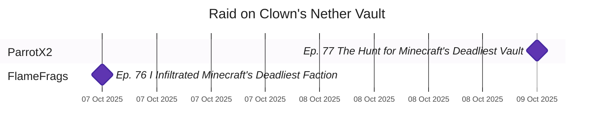

# Raid on Clown's Nether Vault

<figure class="uu-figure uu-wide" markdown="span">
  { .uu-fig-thumb loading=lazy referrerpolicy=no-referrer }
  <figcaption markdown>Thumbnail of [Ep. 76: I Infiltrated Minecraft's Deadliest Faction](../episodes/season-2/076-i-infiltrated-minecrafts-deadliest-faction.md), where it starts</figcaption>
</figure>

## Summary

During [ClownPierce](../characters/clownpierce.md)'s Nether festival, [ParrotX2](../characters/parrotx2.md), [TheobaldTheBird](../characters/theobaldthebird.md) and [FlameFrags](../characters/flamefrags.md) form a wary alliance to find the King of the Nether's secret vault. The plan comes down to kidnapping [FerreMC](../characters/ferremc.md) for its coordinates, and it ends with Flame hiring Parrot for a new job.

## Perspectives

### [FlameFrags](../characters/flamefrags.md)

Flame's side: infiltrating Clown's faction, teaming up with Parrot, and overhearing that Parrot is only using him.

- [I Infiltrated Minecraft's Deadliest Faction](../episodes/season-2/076-i-infiltrated-minecrafts-deadliest-faction.md) (ep. 76, 7 October 2025)

### [ParrotX2](../characters/parrotx2.md)

Parrot's side: the Clown-banner disguises, the festival quiz, extracting Ferre through a TNT-blasted wall, and Flame's request to find the Mafia's tomb and learn what happened to Wemmbu.

- [The Hunt for Minecraft's Deadliest Vault](../episodes/season-2/077-the-hunt-for-minecrafts-deadliest-vault.md) (ep. 77, 9 October 2025)

## Timeline

### [I Infiltrated Minecraft's Deadliest Faction](../episodes/season-2/076-i-infiltrated-minecrafts-deadliest-faction.md) (ep. 76, FlameFrags)

[FlameFrags](../characters/flamefrags.md) goes into [ClownPierce](../characters/clownpierce.md)'s Nether to kill him, and runs into [ParrotX2](../characters/parrotx2.md) and [TheobaldTheBird](../characters/theobaldthebird.md) disguised as Clown's guards.

- GeneralChungus is killed; Clown's army is defeated by Flame.
- Ferre is kidnapped and released.
- Flame and Parrot strike a deal over the Mafia's tomb and Wemmbu.

### [The Hunt for Minecraft's Deadliest Vault](../episodes/season-2/077-the-hunt-for-minecrafts-deadliest-vault.md) (ep. 77, ParrotX2)

The same raid from [ParrotX2](../characters/parrotx2.md)'s side.

- Parrot loots Clown's Nether vault and escapes.
- Flame betrays, then saves, Parrot and Theo.
- Parrot agrees to find the Mafia's tomb and Wemmbu's fate.

## Aftermath

- Parrot escapes with items from the vault; Flame, after betraying Parrot and Theo and then turning on Clown, makes Parrot a deal: find out what happened to Wemmbu in exchange for the Mafia's tomb.
