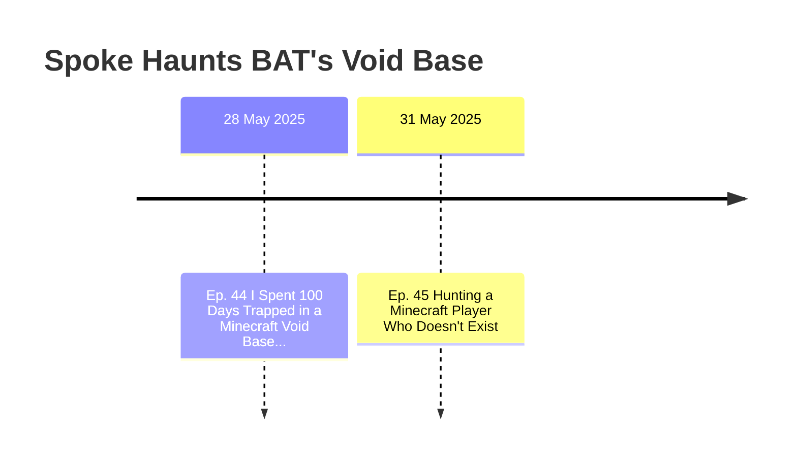

# Spoke Haunts BAT's Void Base

<figure class="uu-figure uu-wide" markdown="span">
  { .uu-fig-thumb loading=lazy referrerpolicy=no-referrer }
  <figcaption markdown>Thumbnail of [Ep. 44: I Spent 100 Days Trapped in a Minecraft Void Base...](../episodes/season-2/044-i-spent-100-days-trapped-in-a-minecraft-void-base.md), where it starts</figcaption>
</figure>

## Summary

While the [Bounty Assassin Team](../factions/bounty-assassin-team.md) is consumed by its hunt for the Director, [SpokeIsHere](../characters/spokeishere.md) is secretly living in the vents of their base over the void. From Spoke's side it's a 100-day prank campaign; from [ParrotX2](../characters/parrotx2.md)'s side it's a terrifying intruder who must be the Director, until it turns out to be Spoke.

## Perspectives

### [SpokeIsHere](../characters/spokeishere.md)

Spoke's side: sneaking in behind Jumper, spying on BAT meetings, surviving the flooded vents, and signing his sabotage "I AM THE DIRECTOR".

- [I Spent 100 Days Trapped in a Minecraft Void Base...](../episodes/season-2/044-i-spent-100-days-trapped-in-a-minecraft-void-base.md) (ep. 44, 28 May 2025)

### [ParrotX2](../characters/parrotx2.md)

Parrot's side: invisibility particles, a lockdown and strange events in the base, until BAT corner the intruder and find Spoke, who escapes with chorus fruit.

- [Hunting a Minecraft Player Who Doesn't Exist](../episodes/season-2/045-hunting-a-minecraft-player-who-doesnt-exist.md) (ep. 45, 31 May 2025)

## Timeline

### [I Spent 100 Days Trapped in a Minecraft Void Base...](../episodes/season-2/044-i-spent-100-days-trapped-in-a-minecraft-void-base.md) (ep. 44, SpokeIsHere)

[SpokeIsHere](../characters/spokeishere.md) spends 100 days hiding inside [JumperWho](../characters/jumperwho.md)'s void base, the new home of the [Bounty Assassin Team](../factions/bounty-assassin-team.md).

- BAT's void base is sabotaged; its pets and a spy are killed.
- Spoke's "I am the Director" signs send BAT after the wrong person.
- Spoke escapes custody.

### [Hunting a Minecraft Player Who Doesn't Exist](../episodes/season-2/045-hunting-a-minecraft-player-who-doesnt-exist.md) (ep. 45, ParrotX2)

[ParrotX2](../characters/parrotx2.md) and the [Bounty Assassin Team](../factions/bounty-assassin-team.md) chase the Director: through a zombie trap, [Redstone Town](../places/redstone-town.md), a fake Director ([MrCube6](../characters/mrcube6.md)), a fake intruder ([SpokeIsHere](../characters/spokeishere.md)) and a planted clue.

- The Director is revealed to be Wifies, who faked his death.
- Parrot stops chasing the Director and follows Wifies.
- Jumper rejoins BAT; Leo and Parrot part on bad terms.

## Aftermath

- In the confusion, the real Director is unmasked as [Wifies](../characters/wifies.md) (ep. 45), who soon locks Parrot in [Paragon](../places/paragon.md).
