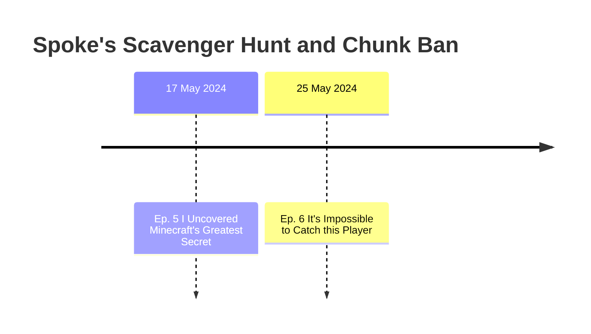

# Spoke's Scavenger Hunt and Chunk Ban

<figure class="uu-figure uu-wide" markdown="span">
  { .uu-fig-thumb loading=lazy referrerpolicy=no-referrer }
  <figcaption markdown>Thumbnail of [Ep. 5: I Uncovered Minecraft's Greatest Secret](../episodes/season-1/005-i-uncovered-minecrafts-greatest-secret.md), where it starts</figcaption>
</figure>

## Summary

[SpokeIsHere](../characters/spokeishere.md) sends [ParrotX2](../characters/parrotx2.md) and [Wifies](../characters/wifies.md) on a scavenger hunt for a "secret", while [Wemmbu](../characters/wemmbu.md) and [PrinceZam](../characters/princezam.md) hunt Spoke himself. The two stories cross at the [Zam Empire](../places/zam-empire.md) and the lighthouse, and both end in the same moment: Spoke, cornered, steps into a chunk ban, after Wifies has already been banned by one.

## Perspectives

### [ParrotX2](../characters/parrotx2.md)

Parrot's side of the puzzles: the discs, the hidden city, the Morse-code lighthouse, losing Wifies, and Spoke's apology before he steps in.

- [I Uncovered Minecraft's Greatest Secret](../episodes/season-1/005-i-uncovered-minecrafts-greatest-secret.md) (ep. 5, 17 May 2024)

### [Wemmbu](../characters/wemmbu.md)

Wemmbu's side of the manhunt: allying with Zam, fighting Spoke's henchmen, burning the mace rather than handing it over, and the chess-room finale.

- [It's Impossible to Catch this Player](../episodes/season-1/006-its-impossible-to-catch-this-player.md) (ep. 6, 25 May 2024)

## Timeline

### [I Uncovered Minecraft's Greatest Secret](../episodes/season-1/005-i-uncovered-minecrafts-greatest-secret.md) (ep. 5, ParrotX2)

[ParrotX2](../characters/parrotx2.md) receives a music disc from [SpokeIsHere](../characters/spokeishere.md) promising a server-changing secret, and brings his friend [Wifies](../characters/wifies.md) on a huge scavenger hunt.

- Wifies is chunk banned, by his own choice, to save Parrot.
- Spoke steps into a chunk ban to escape the Zam Empire.
- Parrot keeps the spyglass, a symbol of trust that matters again much later.

### [It's Impossible to Catch this Player](../episodes/season-1/006-its-impossible-to-catch-this-player.md) (ep. 6, Wemmbu)

The same weeks from [Wemmbu](../characters/wemmbu.md)'s side.

- Chunk banned: TheRealSquiddo, RealReeon, Derapchu, JumperWho, Arcn, Only_A_Squid, Sharooh, Sharkilz_, Fantst, and finally Spoke.
- TeamKalal is blown up in the castle battle.
- The Zam Empire decides to build prisons around the chunk bans.

## Aftermath

- With Spoke and Wifies sharing a [chunk-ban](../mechanics/chunk-ban.md) prison, Parrot and Rekrap2 tour the [Zam Empire](../places/zam-empire.md)'s prisons, freeing Derapchu, Fantst and JumperWho, and finally Wifies, and Spoke by accident.
- Furious, [PrinceZam](../characters/princezam.md) hires [ClownPierce](../characters/clownpierce.md) to kill Parrot, which begins Clown's manhunt.
