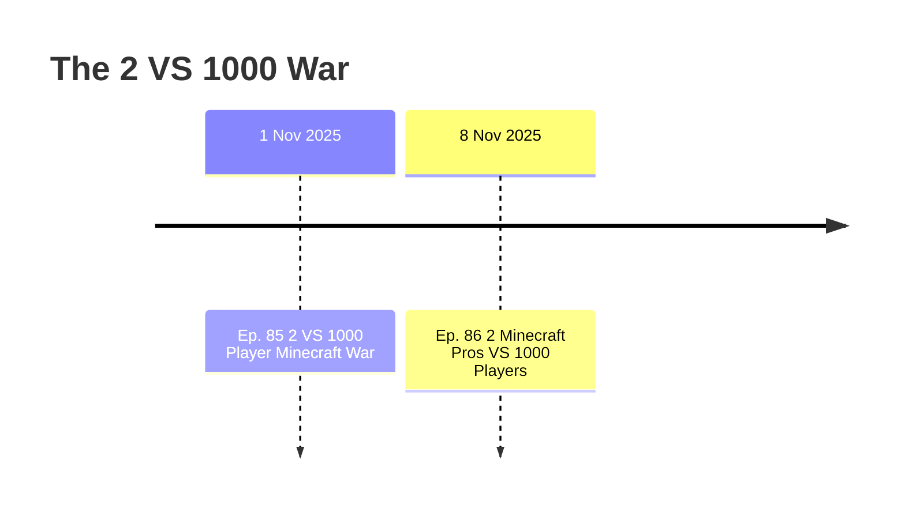

# The 2 VS 1000 War

<figure class="uu-figure uu-wide" markdown="span">
  { .uu-fig-thumb loading=lazy referrerpolicy=no-referrer }
  <figcaption markdown>Thumbnail of [Ep. 85: 2 VS 1000 Player Minecraft War](../episodes/season-2/085-2-vs-1000-player-minecraft-war.md), where it starts</figcaption>
</figure>

## Summary

To get [LAW](../factions/law.md) off their backs, [Wemmbu](../characters/wemmbu.md) and [FlameFrags](../characters/flamefrags.md) agree to fight [LettuceK](../characters/lettucek.md)'s whole army together: two players against a thousand. They win, but the truce only lasts until the last LAWman falls. Flame attacks Wemmbu and takes back the title of strongest player, and Lettuce takes the weakened Wemmbu prisoner.

## Perspectives

### [FlameFrags](../characters/flamefrags.md)

Flame's side: still bitter about the "dishonourable" loss, riding to the battlefield for aura, and Lettuce's warning that he hasn't played all his cards.

- [2 VS 1000 Player Minecraft War](../episodes/season-2/085-2-vs-1000-player-minecraft-war.md) (ep. 85, 1 November 2025)

### [Wemmbu](../characters/wemmbu.md)

Wemmbu's side: funding the war by robbing Capitol City, sharing gear with Flame, and the betrayal and capture after the battle.

- [2 Minecraft Pros VS 1000 Players](../episodes/season-2/086-2-minecraft-pros-vs-1000-players.md) (ep. 86, 8 November 2025)

## Timeline

### [2 VS 1000 Player Minecraft War](../episodes/season-2/085-2-vs-1000-player-minecraft-war.md) (ep. 85, FlameFrags)

[FlameFrags](../characters/flamefrags.md) and [Wemmbu](../characters/wemmbu.md) take on [LettuceK](../characters/lettucek.md)'s 1,000-player [LAW](../factions/law.md) army at a giant statue.

- LAW's 1,000-player army is wiped out.
- Flame beats Wemmbu and takes back the title of strongest player.
- Lettuce reveals a second plan.

### [2 Minecraft Pros VS 1000 Players](../episodes/season-2/086-2-minecraft-pros-vs-1000-players.md) (ep. 86, Wemmbu)

The same war from [Wemmbu](../characters/wemmbu.md)'s side, from LAW's ambushes and the alliance with [FlameFrags](../characters/flamefrags.md), through robbing [Capital City](../places/capital-city.md)'s black market and trading at [Merchant City](../places/merchant-city.md), to the battle at the statue.

- The LAW army is destroyed, and Wemmbu concedes the title to Flame.
- Lettuce gets a mace and captures Wemmbu, leading to [The LAW Prison](the-law-prison.md).

## Aftermath

- The truce ends with the last lawman. LettuceK exiles Flame and imprisons Wemmbu ([The LAW Prison](the-law-prison.md)).
