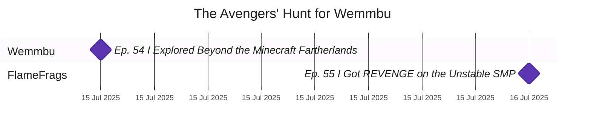

# The Avengers' Hunt for Wemmbu

<figure class="uu-figure uu-wide" markdown="span">
  { .uu-fig-thumb loading=lazy referrerpolicy=no-referrer }
  <figcaption markdown>Thumbnail of [Ep. 54: I Explored Beyond the Minecraft Fartherlands](../episodes/season-2/054-i-explored-beyond-the-minecraft-fartherlands.md), where it starts</figcaption>
</figure>

## Summary

Freed by [FlameFrags](../characters/flamefrags.md), [Jaden_MAN](../characters/jaden-man.md) gathers every player [Wemmbu](../characters/wemmbu.md) has wronged into [The Avengers](../factions/the-avengers.md) to hunt him across the [Far Lands](../places/far-lands.md). The team falls apart, Flame takes command and gets hold of Wemmbu's mace from [Sharpness](../characters/sharpness.md), while Wemmbu keeps slipping away in search of [The Forge](../places/the-forge.md).

## Perspectives

### [Wemmbu](../characters/wemmbu.md)

Wemmbu's side: being ambushed again and again, the golden temple and the first news of The Forge.

- [I Explored Beyond the Minecraft Fartherlands](../episodes/season-2/054-i-explored-beyond-the-minecraft-fartherlands.md) (ep. 54, 15 July 2025)

### [FlameFrags](../characters/flamefrags.md)

Flame's side: herding a chaotic team, the mace deal with Sharpness, and his own stasis being pulled at the end.

- [I Got REVENGE on the Unstable SMP](../episodes/season-2/055-i-got-revenge-on-the-unstable-smp.md) (ep. 55, 16 July 2025)

## Timeline

### [I Explored Beyond the Minecraft Fartherlands](../episodes/season-2/054-i-explored-beyond-the-minecraft-fartherlands.md) (ep. 54, Wemmbu)

Deeper in the Far Lands, [Wemmbu](../characters/wemmbu.md) and [Eggchan](../characters/eggchan.md) are hunted by [The Avengers](../factions/the-avengers.md), an alliance of everyone Wemmbu has wronged.

- Lakerek and Mxsterwu are killed.
- The Avengers' attack fails; Wemmbu briefly allies with FlameFrags and gets his mace back.
- Wemmbu and Egg stay in the Far Lands to search for the Forge.

### [I Got REVENGE on the Unstable SMP](../episodes/season-2/055-i-got-revenge-on-the-unstable-smp.md) (ep. 55, FlameFrags)

[Jaden_MAN](../characters/jaden-man.md) wants revenge on [Wemmbu](../characters/wemmbu.md), so he and [FlameFrags](../characters/flamefrags.md) form [The Avengers](../factions/the-avengers.md) from Wemmbu's old enemies and follow him into the [Far Lands](../places/far-lands.md).

- The Avengers turn on each other and fall apart.
- Wemmbu gets his mace back from Flame.
- Flame's stasis is pulled, leading into the LAW trap.

## Aftermath

- Flame's betrayal in the Spikelands breaks the team and starts his feud with Jaden ([Betrayal Arc](../arcs/betrayal-arc.md)).
- Wemmbu and Egg push on towards the end of the Far Lands in search of [The Forge](../places/the-forge.md).
