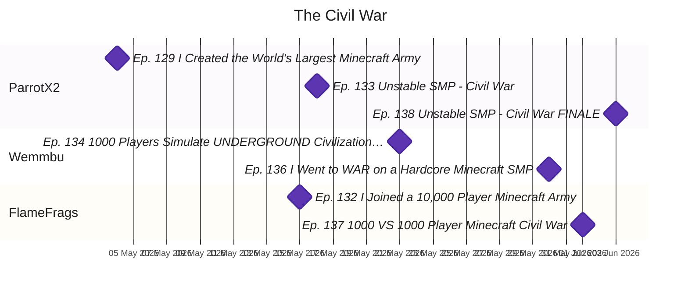

# The Civil War

<figure class="uu-figure uu-wide" markdown="span">
  { .uu-fig-thumb loading=lazy referrerpolicy=no-referrer }
  <figcaption markdown>Thumbnail of [Ep. 129: I Created the World's Largest Minecraft Army](../episodes/season-2-plus/129-i-created-the-worlds-largest-minecraft-army.md), where it starts</figcaption>
</figure>

## Summary

King [ParrotX2](../characters/parrotx2.md)'s open Spawn splits the server into new and old players. [Saparata](../characters/saparata.md)'s [Cindercrest](../factions/cindercrest.md), allied with [Arachn1d](../characters/arachn1d.md)'s [Kingdom of the Caves](../factions/kingdom-of-the-caves.md), goes to war with Parrot's kingdom; [FlameFrags](../characters/flamefrags.md) fights for Cindercrest out of loyalty to [Lomedy](../characters/lomedy.md), and [Wemmbu](../characters/wemmbu.md) is forced to fight for the caves because Arachn1d holds [Eggchan](../characters/eggchan.md) hostage. The war ends with Parrot exiled and Saparata crowned the second king.

## Perspectives

### [ParrotX2](../characters/parrotx2.md)

Parrot's side: building the largest army ever, losing Fort Feather, the blimp sabotage, and losing his crown.

- [I Created the World's Largest Minecraft Army](../episodes/season-2-plus/129-i-created-the-worlds-largest-minecraft-army.md) (ep. 129, 4 May 2026)
- [Unstable SMP: Civil War](../episodes/season-2-plus/133-unstable-smp-civil-war.md) (ep. 133, 16 May 2026)
- [Unstable SMP: Civil War FINALE](../episodes/season-2-plus/138-unstable-smp-civil-war-finale.md) (ep. 138, 3 June 2026)

### [FlameFrags](../characters/flamefrags.md)

Flame's side: joining Cindercrest for Lomedy, the blimp with ShoeBilly, crushing his old LAW allies, and ending up alone again.

- [I Joined a 10,000 Player Minecraft Army](../episodes/season-2-plus/132-i-joined-a-10-000-player-minecraft-army.md) (ep. 132, 15 May 2026)
- [1000 VS 1000 Player Minecraft Civil War](../episodes/season-2-plus/137-1000-vs-1000-player-minecraft-civil-war.md) (ep. 137, 1 June 2026)

### [Wemmbu](../characters/wemmbu.md)

Wemmbu's side: fighting as a hostage-held pawn, sparing Parrot on the battlefield, and Arachn1d's betrayal.

- [1000 Players Simulate UNDERGROUND Civilization in Minecraft](../episodes/season-2-plus/134-1000-players-simulate-underground-civilization-in-minecraft.md) (ep. 134, 21 May 2026)
- [I Went to WAR on a Hardcore Minecraft SMP](../episodes/season-2-plus/136-i-went-to-war-on-a-hardcore-minecraft-smp.md) (ep. 136, 30 May 2026)

## Timeline

### [I Created the World's Largest Minecraft Army](../episodes/season-2-plus/129-i-created-the-worlds-largest-minecraft-army.md) (ep. 129, ParrotX2)

[Cindercrest](../factions/cindercrest.md) will invade in five days, so King [ParrotX2](../characters/parrotx2.md) sets out to build the largest army the server has seen.

- Parrot's army absorbs the bandits, the Merchant City vanguard and much of LAW.
- DanchoGold escapes; ralamus and Sarge's loyalists are killed.
- FlameFrags is seen with Cindercrest, as the civil war approaches.

### [I Joined a 10,000 Player Minecraft Army](../episodes/season-2-plus/132-i-joined-a-10-000-player-minecraft-army.md) (ep. 132, FlameFrags)

The civil war's opening from [FlameFrags](../characters/flamefrags.md)' side.

- Cindercrest takes Fort Feather but is crushed at Merchant City.
- Arachn1d's kingdom wins Egg at the auction; Cindercrest allies with it.
- Flame and Lomedy fall out over the war.

### [Unstable SMP: Civil War](../episodes/season-2-plus/133-unstable-smp-civil-war.md) (ep. 133, ParrotX2)

The civil war from King [ParrotX2](../characters/parrotx2.md)'s side.

- Fort Feather and Highwater City fall to Cindercrest; Merchant City holds.
- Wemmbu and the [Kingdom of the Caves](../factions/kingdom-of-the-caves.md) join Cindercrest's side.
- The kingdom's food supply is cut off.

### [1000 Players Simulate UNDERGROUND Civilization in Minecraft](../episodes/season-2-plus/134-1000-players-simulate-underground-civilization-in-minecraft.md) (ep. 134, Wemmbu)

To get [Eggchan](../characters/eggchan.md) back, [Wemmbu](../characters/wemmbu.md) joins [Arachn1d](../characters/arachn1d.md)'s underground [Kingdom of the Caves](../factions/kingdom-of-the-caves.md) stripped to wooden tools, with [Jaden_MAN](../characters/jaden-man.md) at his side.

- Wemmbu becomes royalty and Arachn1d's second-in-command.
- ParamountX is assassinated; Merchant City and Highwater City fall.
- Wemmbu spares Parrot.

### [I Went to WAR on a Hardcore Minecraft SMP](../episodes/season-2-plus/136-i-went-to-war-on-a-hardcore-minecraft-smp.md) (ep. 136, Wemmbu)

[Arachn1d](../characters/arachn1d.md) secretly plans to betray [Cindercrest](../factions/cindercrest.md) and rule the server himself, and uses [Wemmbu](../characters/wemmbu.md) as his weapon: against [ShoeBilly_](../characters/shoebilly.md) at Steampunk City, against [FlameFrags](../characters/flamefrags.md)' army, and finally against everyone at [Capital City](../places/capital-city.md), where Wemmbu's nukes kill hundreds on both sides.

- Lettuce is released to Cindercrest; Reina returns to Parrot.
- Hundreds die and Capital City is destroyed by Wemmbu.
- Arachn1d betrays Wemmbu, dropping him into the start of [The Purge of the Caves](the-purge-of-the-caves.md).

### [1000 VS 1000 Player Minecraft Civil War](../episodes/season-2-plus/137-1000-vs-1000-player-minecraft-civil-war.md) (ep. 137, FlameFrags)

The civil war from [FlameFrags](../characters/flamefrags.md)' side, to its end.

- LAW's army is destroyed at the bridge; Highwater and Steampunk City fall.
- Flame and Lomedy turn against Cindercrest and side with Parrot.
- Over 800 die to Wemmbu's orbital at Capital City; Lomedy leaves Flame.

### [Unstable SMP: Civil War FINALE](../episodes/season-2-plus/138-unstable-smp-civil-war-finale.md) (ep. 138, ParrotX2)

The civil war's finale from [ParrotX2](../characters/parrotx2.md)'s side.

- Cindercrest's blimps are destroyed; Reina is traded for Lettuce.
- Capital City is destroyed and hundreds of civilians die.
- Parrot is overthrown and exiled; Saparata becomes the second king.

## Aftermath

- [Saparata](../characters/saparata.md) becomes king; Parrot is exiled ([Exile Arc](../arcs/exile-arc.md)), Reina banished and Fymada jailed.
- Arachn1d's plot to betray Cindercrest, and his hold over Eggchan, lead into [The Purge of the Caves](the-purge-of-the-caves.md).
