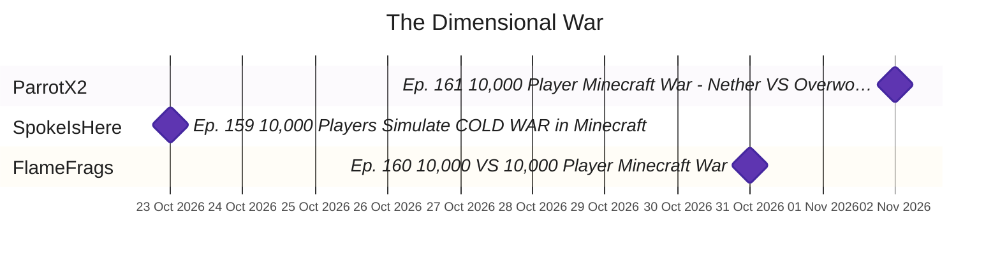

# The Dimensional War

<figure class="uu-figure uu-wide" markdown="span">
  { .uu-fig-thumb loading=lazy referrerpolicy=no-referrer }
  <figcaption markdown>Thumbnail of [Ep. 159: 10,000 Players Simulate COLD WAR in Minecraft](../episodes/season-2-plus/159-10-000-players-simulate-cold-war-in-minecraft.md), where it starts</figcaption>
</figure>

## Summary

The Nether, the End and the Overworld go to war. [ClownPierce](../characters/clownpierce.md)'s [Nether Kingdom](../factions/nether-kingdom.md) and [SpokeIsHere](../characters/spokeishere.md)'s [End Empire](../places/end-empire.md) clash through portals in a cold war, [FlameFrags](../characters/flamefrags.md) leads [LAW](../factions/law.md) against Cindercrest, and [ParrotX2](../characters/parrotx2.md) unites the Overworld's three kings against the Nether's invasion.

## Perspectives

### [SpokeIsHere](../characters/spokeishere.md)

Spoke's side: conquering the Far Lands, the arms race with the Nether Kingdom, and new orbital weapons.

- [10,000 Players Simulate COLD WAR in Minecraft](../episodes/season-2-plus/159-10-000-players-simulate-cold-war-in-minecraft.md) (ep. 159, 23 October 2026)

### [FlameFrags](../characters/flamefrags.md)

Flame's side: allying with LAW against Cindercrest's 10,000 and becoming LAW's new leader.

- [10,000 VS 10,000 Player Minecraft War](../episodes/season-2-plus/160-10-000-vs-10-000-player-minecraft-war.md) (ep. 160, 31 October 2026)

### [ParrotX2](../characters/parrotx2.md)

Parrot's side: the villager-breeding plan, holding off Clown at Newtopia, and the three kings united.

- [10,000 Player Minecraft War: Nether VS Overworld](../episodes/season-2-plus/161-10-000-player-minecraft-war-nether-vs-overworld.md) (ep. 161, 2 November 2026)

## Timeline

### [10,000 Players Simulate COLD WAR in Minecraft](../episodes/season-2-plus/159-10-000-players-simulate-cold-war-in-minecraft.md) (ep. 159, SpokeIsHere)

After taking the [Far Lands](../places/far-lands.md), [SpokeIsHere](../characters/spokeishere.md) is ambushed by [ClownPierce](../characters/clownpierce.md)'s [Nether Kingdom](../factions/nether-kingdom.md) and loses his capital.

- The Nether Kingdom takes NULL's capital; NULL retakes it with the Worms and wardens.
- Shelldon's and Birchington's civilizations fall; the monarchs are overthrown and Slicee rules the Worms.
- Spoke and Clown's Overworld truce is broken; the war moves into the End.

### [10,000 VS 10,000 Player Minecraft War](../episodes/season-2-plus/160-10-000-vs-10-000-player-minecraft-war.md) (ep. 160, FlameFrags)

Free of [Terminus](../places/terminus.md), [FlameFrags](../characters/flamefrags.md) takes temporary command of [LAW](../factions/law.md) in its war against [Cindercrest](../factions/cindercrest.md)'s 10,000 players.

- LAW defeats Cindercrest's invasion; Lettuce leaves Cindercrest.
- Skrilley is rescued from Terminus.
- Flame steps down and Morr0w becomes leader of LAW.

### [10,000 Player Minecraft War: Nether VS Overworld](../episodes/season-2-plus/161-10-000-player-minecraft-war-nether-vs-overworld.md) (ep. 161, ParrotX2)

As [ClownPierce](../characters/clownpierce.md)'s [Nether Kingdom](../factions/nether-kingdom.md) invades, [ParrotX2](../characters/parrotx2.md), [TheobaldTheBird](../characters/theobaldthebird.md) and [ReinaDrop](../characters/reinadrop.md) fight their way to [Spawn](../places/spawn.md) with Parrot's villager, convincing a sceptical [Saparata](../characters/saparata.md) only when Clown appears.

- The Nether Kingdom invades; Highwater City, LAW and Capital City fall.
- Clown is revealed to have framed Parrot through the Capitol City Police Force.
- Newtopia holds; Lettuce, Saparata and Parrot unite the Overworld against Clown.

## Aftermath

- As of ep. 161 the war is still on: the Overworld's three kings stand united at [Newtopia](../places/newtopia.md), the Nether Kingdom has reached the End, FlameFrags is presumed to be there, and Wemmbu is in the Underworld.
