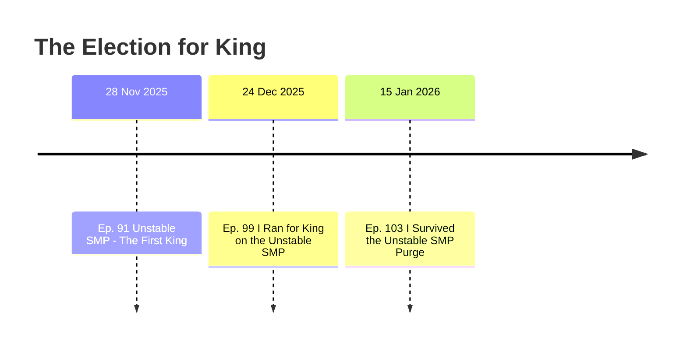

# The Election for King

<figure class="uu-figure uu-wide" markdown="span">
  { .uu-fig-thumb loading=lazy referrerpolicy=no-referrer }
  <figcaption markdown>Thumbnail of [Ep. 91: Unstable SMP: The First King](../episodes/season-2/091-unstable-smp-the-first-king.md), where it starts</figcaption>
</figure>

## Summary

[LettuceK](../characters/lettucek.md) announces an election for the first king of the Unstable SMP. Dozens of candidates enter and are halved every two weeks, while [ParrotX2](../characters/parrotx2.md), picked by the mysterious "Owl", climbs from last place. The election ends with the Purge, the war against [LAW](../factions/law.md), and Parrot crowned king.

## Perspectives

### [ParrotX2](../characters/parrotx2.md)

Parrot's side: the announcement, defending a village from the Phantoms, the campaign, and the road to the crown.

- [Unstable SMP: The First King](../episodes/season-2/091-unstable-smp-the-first-king.md) (ep. 91, 28 November 2025)
- [I Ran for King on the Unstable SMP](../episodes/season-2/099-i-ran-for-king-on-the-unstable-smp.md) (ep. 99, 24 December 2025)
- [I Survived the Unstable SMP Purge](../episodes/season-2/103-i-survived-the-unstable-smp-purge.md) (ep. 103, 15 January 2026)

## Timeline

### [Unstable SMP: The First King](../episodes/season-2/091-unstable-smp-the-first-king.md) (ep. 91, ParrotX2)

A book from a mysterious "Owl" sends [ParrotX2](../characters/parrotx2.md) to [LettuceK](../characters/lettucek.md)'s announcement, where Parrot decides to run for king, and then to the remote Treebo Village, terrorised by bandits called the Phantoms.

- The Phantoms are destroyed; Kibaxmc is killed and HerobaneNair banished.
- PajamaSammy is rescued and Treebo Village saved.
- Parrot qualifies for the election with 109 votes.

### [I Ran for King on the Unstable SMP](../episodes/season-2/099-i-ran-for-king-on-the-unstable-smp.md) (ep. 99, ParrotX2)

The election for king begins at the [Northern Council](../places/northern-council.md).

- Spepticle, the Owl, is executed; a LAW guard is killed by Parrot.
- JumperWho drops out; Parrot reaches the top eight.
- Wemmbu's escape is made public, and Lettuce orders "The Purge".

### [I Survived the Unstable SMP Purge](../episodes/season-2/103-i-survived-the-unstable-smp-purge.md) (ep. 103, ParrotX2)

The second round of the election starts with an assassination: leading candidate Naparizel is killed.

- Naparizel is assassinated, on Lettuce's orders.
- Horace and Fymada endorse Parrot, who reaches the final four.
- Deputy Ace turns against Lettuce.

## Aftermath

- At the final debate, LettuceK declares himself king and jails Parrot, setting up [The War Against LAW](the-war-against-law.md).
