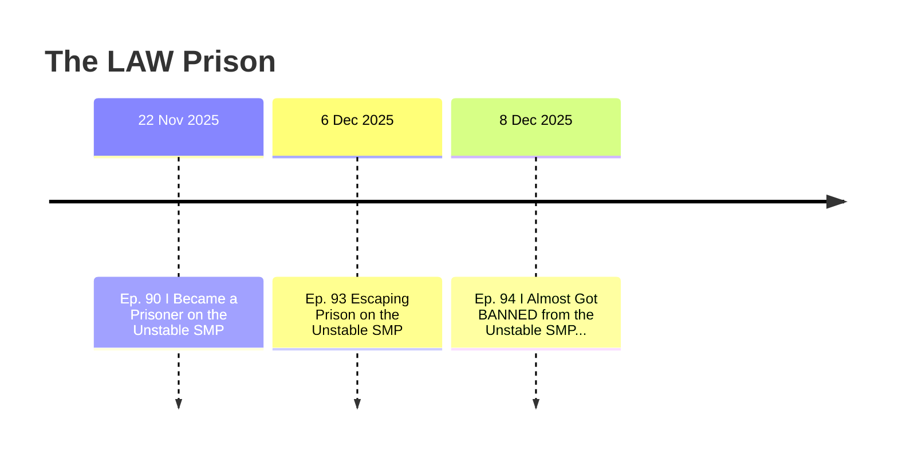

# The LAW Prison

<figure class="uu-figure uu-wide" markdown="span">
  { .uu-fig-thumb loading=lazy referrerpolicy=no-referrer }
  <figcaption markdown>Thumbnail of [Ep. 90: I Became a Prisoner on the Unstable SMP](../episodes/season-2/090-i-became-a-prisoner-on-the-unstable-smp.md), where it starts</figcaption>
</figure>

## Summary

After the 2v1000, [LettuceK](../characters/lettucek.md) imprisons [Wemmbu](../characters/wemmbu.md) in the [LAW Prison](../places/law-city.md) alongside [PrinceZam](../characters/princezam.md), [Fantst](../characters/fantst.md) and Baablu. [SpokeIsHere](../characters/spokeishere.md) keeps breaking in to offer Wemmbu a deal, which Wemmbu refuses, until Wemmbu digs his own way out.

## Perspectives

### [Wemmbu](../characters/wemmbu.md)

Wemmbu's side: forced labour, item checks, a failed horse escape, mapping the guard rooms, and finally tunnelling out.

- [I Became a Prisoner on the Unstable SMP](../episodes/season-2/090-i-became-a-prisoner-on-the-unstable-smp.md) (ep. 90, 22 November 2025)
- [Escaping Prison on the Unstable SMP](../episodes/season-2/093-escaping-prison-on-the-unstable-smp.md) (ep. 93, 6 December 2025)

### [SpokeIsHere](../characters/spokeishere.md)

Spoke's side: with BAT closing in on him, he and Mapicc dig into the prison through a blind spot to reach Wemmbu.

- [I Almost Got BANNED from the Unstable SMP...](../episodes/season-2/094-i-almost-got-banned-from-the-unstable-smp.md) (ep. 94, 8 December 2025)

## Timeline

### [I Became a Prisoner on the Unstable SMP](../episodes/season-2/090-i-became-a-prisoner-on-the-unstable-smp.md) (ep. 90, Wemmbu)

In the [LAW prison](../places/law-city.md), [Wemmbu](../characters/wemmbu.md) is stripped, put in a prisoner skin and guarded by [Loppezz](../characters/loppezz.md), alongside old enemies [Fantst](../characters/fantst.md) and Baablu.

- Wemmbu is imprisoned in LAW's prison.
- His escape fails and he's put in solitary.
- Spoke offers him a deal, which he refuses for now.

### [Escaping Prison on the Unstable SMP](../episodes/season-2/093-escaping-prison-on-the-unstable-smp.md) (ep. 93, Wemmbu)

After a week in solitary, [Wemmbu](../characters/wemmbu.md) plans a real escape from the [LAW prison](../places/law-city.md) with [PrinceZam](../characters/princezam.md), [Fantst](../characters/fantst.md) and Baablu: smuggling, signs under mining fatigue, a sergeant's training camp, and a raid on a guard room's ender chest.

- Wemmbu, Zam, Fantst and Baablu escape the LAW prison.
- Two guards are killed by Spoke; Loppezz's guard army is destroyed.
- Wemmbu owes Spoke, and Lomedy stays in prison by choice.

### [I Almost Got BANNED from the Unstable SMP...](../episodes/season-2/094-i-almost-got-banned-from-the-unstable-smp.md) (ep. 94, SpokeIsHere)

[Leow0ok](../characters/leow0ok.md)'s hunt for the missing armour closes in on [SpokeIsHere](../characters/spokeishere.md): the spies blow up Quackenstein's family's home and Leo hands Spoke over to LAW.

- Quackenstein's family's home is destroyed; the family escapes.
- The LAW prisoners are freed by Spoke.
- Leo proves Spoke's guilt, and Spoke is left waiting for BAT.

## Aftermath

- Out of prison, Wemmbu finds every door closed and is sent to Spoke for help; Leow0ok hands Spoke to LAW.
