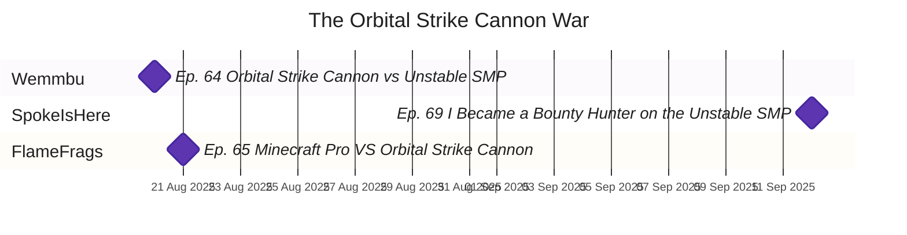

# The Orbital Strike Cannon War

<figure class="uu-figure uu-wide" markdown="span">
  { .uu-fig-thumb loading=lazy referrerpolicy=no-referrer }
  <figcaption markdown>Thumbnail of [Ep. 64: Orbital Strike Cannon vs Unstable SMP](../episodes/season-2/064-orbital-strike-cannon-vs-unstable-smp.md), where it starts</figcaption>
</figure>

## Summary

Armed with orbital strike cannons from the Far Lands, [Wemmbu](../characters/wemmbu.md) tears across the server hunting [FlameFrags](../characters/flamefrags.md) for the title of strongest player. Flame, low on resources and secretly doing quests for [SpokeIsHere](../characters/spokeishere.md), loses the showdown, and Spoke, now a bounty hunter, is there to watch and take advantage.

## Perspectives

### [Wemmbu](../characters/wemmbu.md)

Wemmbu's side: nuking Capital City, a LAW city and Jaden's castle on the way to Flame.

- [Orbital Strike Cannon vs Unstable SMP](../episodes/season-2/064-orbital-strike-cannon-vs-unstable-smp.md) (ep. 64, 20 August 2025)

### [FlameFrags](../characters/flamefrags.md)

Flame's side: Spoke's quests, the Skullhound bandits, and losing to the cannons and his title.

- [Minecraft Pro VS Orbital Strike Cannon](../episodes/season-2/065-minecraft-pro-vs-orbital-strike-cannon.md) (ep. 65, 21 August 2025)

### [SpokeIsHere](../characters/spokeishere.md)

Spoke's side: bounty-hunting for BAT, and stealing Flame's shulker during the fight as "proof" of Flame's death.

- [I Became a Bounty Hunter on the Unstable SMP](../episodes/season-2/069-i-became-a-bounty-hunter-on-the-unstable-smp.md) (ep. 69, 12 September 2025)

## Timeline

### [Orbital Strike Cannon vs Unstable SMP](../episodes/season-2/064-orbital-strike-cannon-vs-unstable-smp.md) (ep. 64, Wemmbu)

Armed with the [orbital strike cannons](../mechanics/orbital-strike-cannon.md) from the end of the Far Lands, [Wemmbu](../characters/wemmbu.md) sets out to take [FlameFrags](../characters/flamefrags.md)' title as the strongest player.

- Wemmbu beats FlameFrags and takes the title of strongest player.
- Parts of Capital City, all of LAW's city and Jaden's castle are destroyed.
- TREELEAF2021 and LAW's new recruits are killed.

### [Minecraft Pro VS Orbital Strike Cannon](../episodes/season-2/065-minecraft-pro-vs-orbital-strike-cannon.md) (ep. 65, FlameFrags)

Short on resources, [FlameFrags](../characters/flamefrags.md) takes quests from a mysterious invisible player: recover stolen potions, fetch a dried ghast from [ClownPierce](../characters/clownpierce.md)'s Nether, kill the Skullhound bandits.

- Wemmbu defeats Flame, who loses his title.
- The Skullhound bandits Flame finds are killed.
- Spoke reveals the quests were a setup to deliver Flame to Wemmbu.

### [I Became a Bounty Hunter on the Unstable SMP](../episodes/season-2/069-i-became-a-bounty-hunter-on-the-unstable-smp.md) (ep. 69, SpokeIsHere)

Betrayed by [Leow0ok](../characters/leow0ok.md) into an ambush, [SpokeIsHere](../characters/spokeishere.md) and [Mapicc](../characters/mapicc.md) find it's really a recruitment test for the rebuilt [Bounty Assassin Team](../factions/bounty-assassin-team.md).

- Spoke joins the Bounty Assassin Team on a lie.
- Spoke's quests deliver Flame into the fight with Wemmbu.
- The rumour of Wemmbu's death starts at the Mafia stash (see [Wemmbu's Fake Death](wemmbus-fake-death.md)).

## Aftermath

- Flame loses his title and starts again in iron. Wemmbu, having finally beaten him, fakes his death ([Wemmbu's Fake Death](wemmbus-fake-death.md)).
