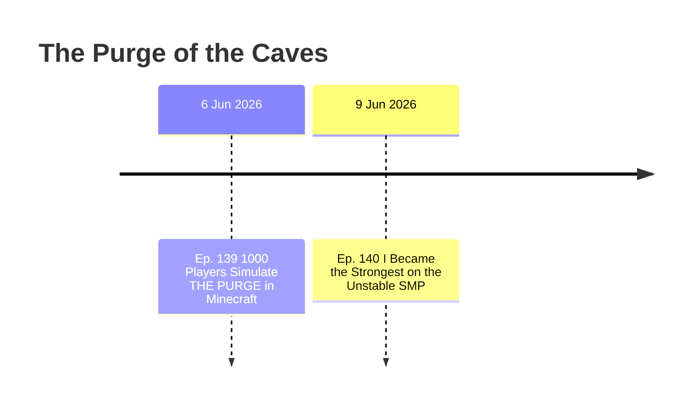

# The Purge of the Caves

<figure class="uu-figure uu-wide" markdown="span">
  { .uu-fig-thumb loading=lazy referrerpolicy=no-referrer }
  <figcaption markdown>Thumbnail of [Ep. 139: 1000 Players Simulate THE PURGE in Minecraft](../episodes/season-2-plus/139-1000-players-simulate-the-purge-in-minecraft.md), where it starts</figcaption>
</figure>

## Summary

[Arachn1d](../characters/arachn1d.md) runs a purge inside the [Kingdom of the Caves](../factions/kingdom-of-the-caves.md) while [Wemmbu](../characters/wemmbu.md) searches for the stasis chambers that keep its prisoners in line. [FlameFrags](../characters/flamefrags.md), who wants one more real fight with the only rival to his title, goes underground to find him.

## Perspectives

### [Wemmbu](../characters/wemmbu.md)

Wemmbu's side: surviving the purge without blocks or crafting tables, and teaming up with Yungyx and Codmaster.

- [1000 Players Simulate THE PURGE in Minecraft](../episodes/season-2-plus/139-1000-players-simulate-the-purge-in-minecraft.md) (ep. 139, 6 June 2026)

### [FlameFrags](../characters/flamefrags.md)

Flame's side: following BanditKing to the hidden pearls, sealing Spongs in obsidian, and getting Wemmbu's promise of a real fight.

- [I Became the Strongest on the Unstable SMP](../episodes/season-2-plus/140-i-became-the-strongest-on-the-unstable-smp.md) (ep. 140, 9 June 2026)

## Timeline

### [1000 Players Simulate THE PURGE in Minecraft](../episodes/season-2-plus/139-1000-players-simulate-the-purge-in-minecraft.md) (ep. 139, Wemmbu)

Dropped into [Arachn1d](../characters/arachn1d.md)'s "purge", a vast arena where the whole [Kingdom of the Caves](../factions/kingdom-of-the-caves.md) hunts each other, [Wemmbu](../characters/wemmbu.md) is the highest-value target.

- Wemmbu survives the purge with Yungy, Jaden, Codmaster and Egg.
- InfamousJJ is killed; BanditKing is humbled.
- Egg is taken again, and Wemmbu turns against Arachn1d.

### [I Became the Strongest on the Unstable SMP](../episodes/season-2-plus/140-i-became-the-strongest-on-the-unstable-smp.md) (ep. 140, FlameFrags)

[FlameFrags](../characters/flamefrags.md) holds the title of strongest player, and only [Wemmbu](../characters/wemmbu.md) can challenge it.

- Flame wins the fight, and gives Wemmbu Egg's pearls.
- Spongs is walled in at Merchant City.
- Flame and Wemmbu promise each other a real fight.

## Aftermath

- Wemmbu turns on Arachn1d; in ep. 150 he frees Egg for good and Yungyx becomes king of the [Kingdom of the Caves](../factions/kingdom-of-the-caves.md).
