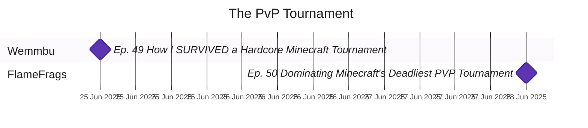

# The PvP Tournament

<figure class="uu-figure uu-wide" markdown="span">
  { .uu-fig-thumb loading=lazy referrerpolicy=no-referrer }
  <figcaption markdown>Thumbnail of [Ep. 49: How I SURVIVED a Hardcore Minecraft Tournament](../episodes/season-2/049-how-i-survived-a-hardcore-minecraft-tournament.md), where it starts</figcaption>
</figure>

## Summary

AJTHEBOLD hosts a PvP tournament to settle who is the strongest player on the server. [Wemmbu](../characters/wemmbu.md) and [FlameFrags](../characters/flamefrags.md) both enter hoping for a rematch with each other, fight through a bracket that includes [WyLL](../characters/wyll.md), [FerreMC](../characters/ferremc.md), [Sharpness](../characters/sharpness.md) and [TheobaldTheBird](../characters/theobaldthebird.md), and meet in the final, which Flame wins.

## Perspectives

### [Wemmbu](../characters/wemmbu.md)

Wemmbu's side: no elytra allowed, an unlikely tip from Wyll, hiding his mace tricks until Flame looks away, and losing the final.

- [How I SURVIVED a Hardcore Minecraft Tournament](../episodes/season-2/049-how-i-survived-a-hardcore-minecraft-tournament.md) (ep. 49, 25 June 2025)

### [FlameFrags](../characters/flamefrags.md)

Flame's side: the three-totem rules, an easy run through the bracket, needling Wemmbu between rounds, and taking the title.

- [Dominating Minecraft's Deadliest PVP Tournament](../episodes/season-2/050-dominating-minecrafts-deadliest-pvp-tournament.md) (ep. 50, 28 June 2025)

## Timeline

### [How I SURVIVED a Hardcore Minecraft Tournament](../episodes/season-2/049-how-i-survived-a-hardcore-minecraft-tournament.md) (ep. 49, Wemmbu)

[Wemmbu](../characters/wemmbu.md) enters AJTHEBOLD's PvP tournament for another shot at [FlameFrags](../characters/flamefrags.md), with no [Elytra](../mechanics/elytra.md) allowed.

- FlameFrags wins the tournament.
- Wemmbu beats Epaxialfx, Wyll and Sharpness to reach the final.

### [Dominating Minecraft's Deadliest PVP Tournament](../episodes/season-2/050-dominating-minecrafts-deadliest-pvp-tournament.md) (ep. 50, FlameFrags)

The same tournament from [FlameFrags](../characters/flamefrags.md)' side.

- FlameFrags wins the tournament, beating Willsion, Ferre, Theo and Wemmbu.

## Aftermath

- Tournament fighter [Sharpness](../characters/sharpness.md) steals Wemmbu's mace Crucible and flees to the [Far Lands](../places/far-lands.md), starting the [Farlands Arc](../arcs/farlands-arc.md).
