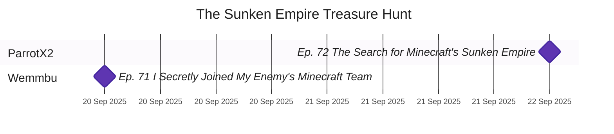

# The Sunken Empire Treasure Hunt

<figure class="uu-figure uu-wide" markdown="span">
  { .uu-fig-thumb loading=lazy referrerpolicy=no-referrer }
  <figcaption markdown>Thumbnail of [Ep. 71: I Secretly Joined My Enemy's Minecraft Team](../episodes/season-2/071-i-secretly-joined-my-enemys-minecraft-team.md), where it starts</figcaption>
</figure>

## Summary

A treasure in [The Great Sea](../places/the-great-sea.md) draws in [ParrotX2](../characters/parrotx2.md) and [TheobaldTheBird](../characters/theobaldthebird.md), [Boosfer](../characters/boosfer.md), [Jaden_MAN](../characters/jaden-man.md)'s pirates, and [Wemmbu](../characters/wemmbu.md), who is in disguise and has joined Jaden's crew to get to Boosfer. Parrot meets the mysterious invisible player at the sunken city and works out who he really is.

## Perspectives

### [Wemmbu](../characters/wemmbu.md)

Wemmbu's side: joining his old enemy Jaden's pirate crew undercover to hunt Boosfer.

- [I Secretly Joined My Enemy's Minecraft Team](../episodes/season-2/071-i-secretly-joined-my-enemys-minecraft-team.md) (ep. 71, 20 September 2025)

### [ParrotX2](../characters/parrotx2.md)

Parrot's side: following DragonMC's clue, the Rangers' prison, the argument with Theo, and the encounter with the invisible player.

- [The Search for Minecraft's Sunken Empire](../episodes/season-2/072-the-search-for-minecrafts-sunken-empire.md) (ep. 72, 22 September 2025)

## Timeline

### [I Secretly Joined My Enemy's Minecraft Team](../episodes/season-2/071-i-secretly-joined-my-enemys-minecraft-team.md) (ep. 71, Wemmbu)

Hearing that [Boosfer](../characters/boosfer.md) is after treasure in [The Great Sea](../places/the-great-sea.md), the disguised [Wemmbu](../characters/wemmbu.md) signs up with [Jaden_MAN](../characters/jaden-man.md)'s pirates.

- Boomie and TheLobsterMan are killed.
- Jaden learns Wemmbu is alive and gets a pirate empire, on condition he stays in the Great Sea.
- Parrot witnesses the killing and starts to suspect who the invisible player is.

### [The Search for Minecraft's Sunken Empire](../episodes/season-2/072-the-search-for-minecrafts-sunken-empire.md) (ep. 72, ParrotX2)

DragonMC hands [ParrotX2](../characters/parrotx2.md) and [TheobaldTheBird](../characters/theobaldthebird.md) a clue to a sunken empire in [The Great Sea](../places/the-great-sea.md).

- The Sunken Empire's treasure is claimed by Parrot.
- Boomie is killed by the invisible player.
- Parrot works out the invisible player's identity; he and Theo reconcile.

## Aftermath

- Wemmbu kills TheLobsterMan, and Jaden turns Ranger Point into [Pirate City](../places/pirate-city.md).
- With Boomie dead, only Boosfer knows the disguised Wemmbu is alive.
