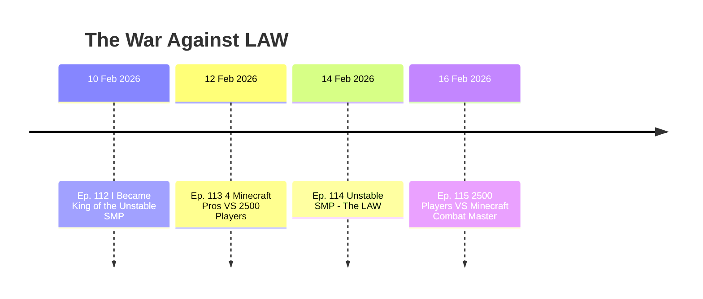

# The War Against LAW

<figure class="uu-figure uu-wide" markdown="span">
  { .uu-fig-thumb loading=lazy referrerpolicy=no-referrer }
  <figcaption markdown>Thumbnail of [Ep. 112: I Became King of the Unstable SMP](../episodes/season-2/112-i-became-king-of-the-unstable-smp.md), where it starts</figcaption>
</figure>

## Summary

The Season 2 finale, told from all four POVs. [LettuceK](../characters/lettucek.md) crowns himself king and imprisons [ParrotX2](../characters/parrotx2.md), and every protagonist has their own reason to fight. [SpokeIsHere](../characters/spokeishere.md) and [JumperWho](../characters/jumperwho.md) battle the combined [Bounty Assassin Team](../factions/bounty-assassin-team.md) and [LAW](../factions/law.md), [Wemmbu](../characters/wemmbu.md) and [FlameFrags](../characters/flamefrags.md) break their friends out of LAW HQ, and they all meet at the [Northern Council](../places/northern-council.md). Lettuce is defeated, [Leow0ok](../characters/leow0ok.md) dies, and Parrot is confirmed as king.

## Perspectives

### [ParrotX2](../characters/parrotx2.md)

Parrot's side: Lettuce's rise and fall, being arrested, and walking out to the crowd wearing the crown.

- [I Became King of the Unstable SMP](../episodes/season-2/112-i-became-king-of-the-unstable-smp.md) (ep. 112, 10 February 2026)

### [SpokeIsHere](../characters/spokeishere.md)

Spoke's side: arrow cannons, prison breaks, finding Parrot, and the end of the BAT Arc.

- [4 Minecraft Pros VS 2500 Players](../episodes/season-2/113-4-minecraft-pros-vs-2500-players.md) (ep. 113, 12 February 2026)

### [Wemmbu](../characters/wemmbu.md)

Wemmbu's side: Lettuce's threat against Jaden, teaming up with Flame, and the frame-dropping battle at the Council.

- [Unstable SMP: The LAW](../episodes/season-2/114-unstable-smp-the-law.md) (ep. 114, 14 February 2026)

### [FlameFrags](../characters/flamefrags.md)

Flame's side: his combat-master training put to the test, an uneasy alliance, and freeing Lomedy.

- [2500 Players VS Minecraft Combat Master](../episodes/season-2/115-2500-players-vs-minecraft-combat-master.md) (ep. 115, 16 February 2026)

## Timeline

### [I Became King of the Unstable SMP](../episodes/season-2/112-i-became-king-of-the-unstable-smp.md) (ep. 112, ParrotX2)

[LettuceK](../characters/lettucek.md), who began as a miner freed by [ParrotX2](../characters/parrotx2.md), declares himself king and jails Parrot, holding [TheobaldTheBird](../characters/theobaldthebird.md) hostage for an endorsement.

- Deputy Ace is killed by Lettuce after freeing Parrot and Theo.
- LAW is defeated at the Northern Council and Lettuce surrenders.
- Parrot wins the election and becomes king (see [The Election for King](the-election-for-king.md)).

### [4 Minecraft Pros VS 2500 Players](../episodes/season-2/113-4-minecraft-pros-vs-2500-players.md) (ep. 113, SpokeIsHere)

The same war from [SpokeIsHere](../characters/spokeishere.md)'s side.

- Jumper's spies, Th3Blurpenstein and Jaden are freed; Lomedy stays.
- LAW is defeated and Lettuce surrenders.
- Leow0ok dies in the void, killed by his own rigged stasis.

### [Unstable SMP: The LAW](../episodes/season-2/114-unstable-smp-the-law.md) (ep. 114, Wemmbu)

The war against [LAW](../factions/law.md) from [Wemmbu](../characters/wemmbu.md)'s side.

- Jaden is freed; LAW HQ is wrecked.
- LAW is defeated at the Northern Council.
- Wemmbu's vote spares Lettuce, who is caged in obsidian.

### [2500 Players VS Minecraft Combat Master](../episodes/season-2/115-2500-players-vs-minecraft-combat-master.md) (ep. 115, FlameFrags)

The war's end from [FlameFrags](../characters/flamefrags.md)' side.

- LAW is defeated and Lettuce imprisoned.
- Flame frees Lomedy and returns his mace, beginning to make amends.

## Aftermath

- LAW falls, LettuceK is captured, and Parrot is crowned the first King of the Overworld, promising to make Spawn safe within 100 days ([Civil War Arc](../arcs/civil-war-arc.md)).
- LAW is later rebuilt under CircusMaximus_.
