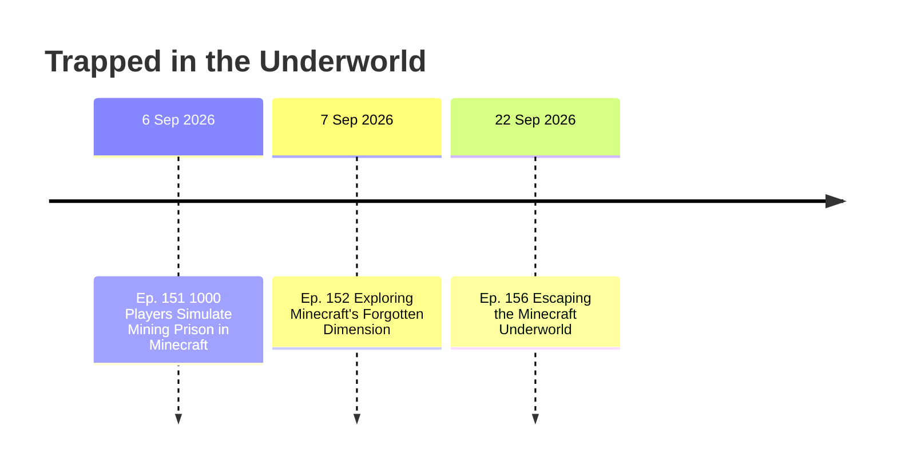

# Trapped in the Underworld

<figure class="uu-figure uu-wide" markdown="span">
  { .uu-fig-thumb loading=lazy referrerpolicy=no-referrer }
  <figcaption markdown>Thumbnail of [Ep. 151: 1000 Players Simulate Mining Prison in Minecraft](../episodes/season-2-plus/151-1000-players-simulate-mining-prison-in-minecraft.md), where it starts</figcaption>
</figure>

## Summary

[The Underworld](../places/the-underworld.md), the forgotten realm below the Nether where blocks can't be broken or placed, catches more and more of the cast. [ParrotX2](../characters/parrotx2.md) leaps into it with a thousand prisoners to escape Clown's mining prison, and [SpokeIsHere](../characters/spokeishere.md) descends looking for the Citadel and leaves [Mapicc](../characters/mapicc.md) stranded there.

## Perspectives

### [ParrotX2](../characters/parrotx2.md)

Parrot's side: the jump through the void hole, the long march out past mazes, wardens and lava, and capture by NULL at the exit.

- [1000 Players Simulate Mining Prison in Minecraft](../episodes/season-2-plus/151-1000-players-simulate-mining-prison-in-minecraft.md) (ep. 151, 6 September 2026)
- [Escaping the Minecraft Underworld](../episodes/season-2-plus/156-escaping-the-minecraft-underworld.md) (ep. 156, 22 September 2026)

### [SpokeIsHere](../characters/spokeishere.md)

Spoke's side: breaking the Nether's bedrock, hunting for the Citadel, and sealing Mapicc in.

- [Exploring Minecraft's Forgotten Dimension](../episodes/season-2-plus/152-exploring-minecrafts-forgotten-dimension.md) (ep. 152, 7 September 2026)

## Timeline

### [1000 Players Simulate Mining Prison in Minecraft](../episodes/season-2-plus/151-1000-players-simulate-mining-prison-in-minecraft.md) (ep. 151, ParrotX2)

Imprisoned by [ClownPierce](../characters/clownpierce.md) in a Nether mining prison of endless wastelands, [ParrotX2](../characters/parrotx2.md) joins an escape team led by SnowLicker_.

- Marcus, NoMic, Mae and SnowLicker_ die; Snow redeems himself at the end.
- Clown's plan to attack the Overworld in six weeks is uncovered.
- Parrot leads the prisoners into the Underworld.

### [Exploring Minecraft's Forgotten Dimension](../episodes/season-2-plus/152-exploring-minecrafts-forgotten-dimension.md) (ep. 152, SpokeIsHere)

Seeking the Citadel, a library described in Jamato's stolen book, [SpokeIsHere](../characters/spokeishere.md) drops alone through the Nether's bedrock into [The Underworld](../places/the-underworld.md), where blocks can't be placed or broken.

- Spoke reaches the Citadel and learns of a weapon stronger than orbitals.
- Mapicc is left trapped in the Underworld, vowing revenge.

### [Escaping the Minecraft Underworld](../episodes/season-2-plus/156-escaping-the-minecraft-underworld.md) (ep. 156, ParrotX2)

Having led a thousand under-geared prisoners into [The Underworld](../places/the-underworld.md), [ParrotX2](../characters/parrotx2.md) tries to get them home.

- Of the thousand prisoners, only Parrot escapes the Underworld.
- StellarNuro, como_squad, hey_b1o and dunea91 die or stay behind.
- NULL captures Parrot and sends him into the End.

## Aftermath

- Mapicc and the Soul Keepers' captives remain below. Parrot escapes but is seized by NULL. Wemmbu and Egg, following Serpentbound's compass, go down on purpose in search of [The Forge](../places/the-forge.md).
