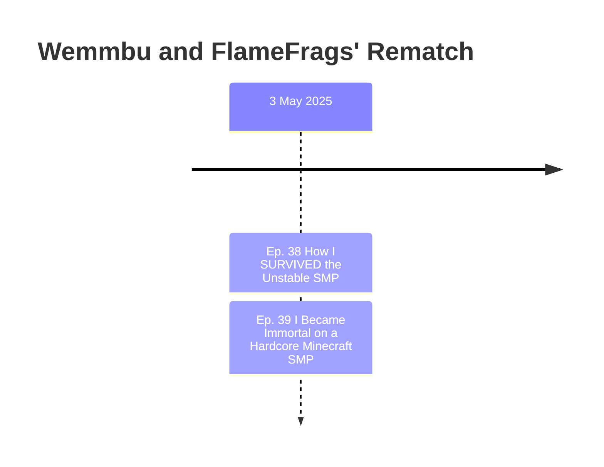

# Wemmbu and FlameFrags' Rematch

<figure class="uu-figure uu-wide" markdown="span">
  { .uu-fig-thumb loading=lazy referrerpolicy=no-referrer }
  <figcaption markdown>Thumbnail of [Ep. 38: How I SURVIVED the Unstable SMP](../episodes/season-2/038-how-i-survived-the-unstable-smp.md), where it starts</figcaption>
</figure>

## Summary

[Wemmbu](../characters/wemmbu.md) has never beaten [FlameFrags](../characters/flamefrags.md), so after rebuilding his gear he turns up at Flame's house and asks for a rematch. It's the first time the two rivals' POVs show the same fight, uploaded on the same day.

## Perspectives

### [Wemmbu](../characters/wemmbu.md)

Wemmbu's side: the road back to full gear, Egg stepping away to study, and the fight itself, where his totem pops before he turns it around with the mace and the two argue over who won.

- [How I SURVIVED the Unstable SMP](../episodes/season-2/038-how-i-survived-the-unstable-smp.md) (ep. 38, 3 May 2025)

### [FlameFrags](../characters/flamefrags.md)

Flame's side: the rematch is one stop on his quest to rebuild a full netherite set, and afterwards Wemmbu points him towards one of Spoke's bases.

- [I Became Immortal on a Hardcore Minecraft SMP](../episodes/season-2/039-i-became-immortal-on-a-hardcore-minecraft-smp.md) (ep. 39, 3 May 2025)

## Timeline

### [How I SURVIVED the Unstable SMP](../episodes/season-2/038-how-i-survived-the-unstable-smp.md) (ep. 38, Wemmbu)

Back from exile, [Wemmbu](../characters/wemmbu.md) and [Eggchan](../characters/eggchan.md) rebuild from basic gear, stealing leather and books from local teams and turning one team against its own leader.

- Eggchan steps away to study; Wemmbu carries on alone.
- Two local teams are wiped out.
- The Wemmbu–Flame rematch ends unresolved.

### [I Became Immortal on a Hardcore Minecraft SMP](../episodes/season-2/039-i-became-immortal-on-a-hardcore-minecraft-smp.md) (ep. 39, FlameFrags)

[FlameFrags](../characters/flamefrags.md) sets out to rebuild a full netherite set, fighting through a dripstone ambush, [SpokeIsHere](../characters/spokeishere.md)'s hired hunters, [TheobaldTheBird](../characters/theobaldthebird.md)'s cart-PvP students and the [Bounty Assassin Team](../factions/bounty-assassin-team.md).

- Flame completes a full netherite set.
- Spoke's hunters, Theo's students and BAT's spies are wiped out.
- The Wemmbu rematch ends without a winner.

## Aftermath

- Wemmbu still hasn't beaten Flame, and enters AJTHEBOLD's tournament for another chance ([The PvP Tournament](the-pvp-tournament.md)).
