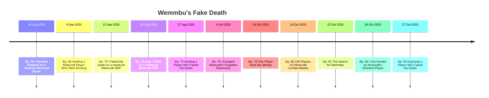

# Wemmbu's Fake Death

<figure class="uu-figure uu-wide" markdown="span">
  { .uu-fig-thumb loading=lazy referrerpolicy=no-referrer }
  <figcaption markdown>Thumbnail of [Ep. 66: I Became Powerful on a Hardcore Minecraft Server](../episodes/season-2/066-i-became-powerful-on-a-hardcore-minecraft-server.md), where it starts</figcaption>
</figure>

## Summary

After defeating [FlameFrags](../characters/flamefrags.md), [Wemmbu](../characters/wemmbu.md) fakes his death and lives under a new identity. Flame refuses to believe it and starts investigating, chasing rumours, missing witnesses and informants like [Boosfer](../characters/boosfer.md), while Wemmbu tries to silence anyone who might expose him. In the end Flame hires [ParrotX2](../characters/parrotx2.md), whose trap reveals the Invisible Knight as Wemmbu.

## Perspectives

### [FlameFrags](../characters/flamefrags.md)

Flame's side: rebuilding after the loss, hearing about Wemmbu's "death", and following the trail of witnesses to work out the truth.

- [I Became Powerful on a Hardcore Minecraft Server](../episodes/season-2/066-i-became-powerful-on-a-hardcore-minecraft-server.md) (ep. 66, 30 August 2025)
- [Hunting a Minecraft Player Who Went Missing](../episodes/season-2/068-hunting-a-minecraft-player-who-went-missing.md) (ep. 68, 9 September 2025)
- [Hunting a Player Who Faked His Death](../episodes/season-2/074-hunting-a-player-who-faked-his-death.md) (ep. 74, 27 September 2025)
- [100 Players VS Minecraft Combat Master](../episodes/season-2/080-100-players-vs-minecraft-combat-master.md) (ep. 80, 18 October 2025)
- [Exposing a Player Who Faked His Death](../episodes/season-2/083-exposing-a-player-who-faked-his-death.md) (ep. 83, 27 October 2025)

### [Wemmbu](../characters/wemmbu.md)

Wemmbu's side: the fake identity, the voice changer, undercover work in the Capital City guard, and hunting the people who know his secret.

- [I Faked My Death on a Hardcore Minecraft SMP](../episodes/season-2/070-i-faked-my-death-on-a-hardcore-minecraft-smp.md) (ep. 70, 13 September 2025)
- [How I "DIED" on a Hardcore Minecraft SMP](../episodes/season-2/073-how-i-died-on-a-hardcore-minecraft-smp.md) (ep. 73, 24 September 2025)
- [I Escaped Minecraft's Forgotten Dimension](../episodes/season-2/075-i-escaped-minecrafts-forgotten-dimension.md) (ep. 75, 6 October 2025)
- [This Player Stole My Identity](../episodes/season-2/079-this-player-stole-my-identity.md) (ep. 79, 14 October 2025)
- [I Got Hunted by Minecraft's Smartest Player](../episodes/season-2/082-i-got-hunted-by-minecrafts-smartest-player.md) (ep. 82, 26 October 2025)

### [ParrotX2](../characters/parrotx2.md)

Parrot's side: taking Flame's job, impersonating Wemmbu to draw him out, and setting the trap that exposes his name.

- [The Search for Wemmbu](../episodes/season-2/081-the-search-for-wemmbu.md) (ep. 81, 22 October 2025)

## Timeline

### [I Became Powerful on a Hardcore Minecraft Server](../episodes/season-2/066-i-became-powerful-on-a-hardcore-minecraft-server.md) (ep. 66, FlameFrags)

Stripped of his title, [FlameFrags](../characters/flamefrags.md) starts again in iron.

- The Skullhound bandits and CraftedJoker are killed.
- Flame has full netherite and a wolf army.
- Flame learns of Wemmbu's death.

### [Hunting a Minecraft Player Who Went Missing](../episodes/season-2/068-hunting-a-minecraft-player-who-went-missing.md) (ep. 68, FlameFrags)

To find out how [Wemmbu](../characters/wemmbu.md) supposedly died, [FlameFrags](../characters/flamefrags.md) traces the rumour back through Luke4472, who has been captured by the Skullhound bandits.

- Luke4472 is rescued; AlbertJustice_ and eight Skullhound bandits are killed.
- The trail leads from Luke to MinuteTech, who escapes Flame.
- Boosfer offers Flame information about Wemmbu.

### [I Faked My Death on a Hardcore Minecraft SMP](../episodes/season-2/070-i-faked-my-death-on-a-hardcore-minecraft-smp.md) (ep. 70, Wemmbu)

After beating Flame, [Wemmbu](../characters/wemmbu.md) fakes his death and takes on a new identity: diamond armour with dune trims, signs instead of speech, then a voice changer.

- Wemmbu's death is faked and widely believed.
- Boosfer's attack on Capital City is repelled; his bandits are killed at Branzy's Castle.
- Boosfer and Boomie escape knowing Wemmbu is alive.

### [How I "DIED" on a Hardcore Minecraft SMP](../episodes/season-2/073-how-i-died-on-a-hardcore-minecraft-smp.md) (ep. 73, Wemmbu)

With Boomie dead, only [Boosfer](../characters/boosfer.md) knows [Wemmbu](../characters/wemmbu.md) is alive, and Boosfer has teamed up with [FlameFrags](../characters/flamefrags.md).

- Salvationism and the Capital City guards are killed by Flame.
- Flame stops trusting Boosfer.
- Wemmbu follows Boosfer into the Nether, straight into a trap.

### [Hunting a Player Who Faked His Death](../episodes/season-2/074-hunting-a-player-who-faked-his-death.md) (ep. 74, FlameFrags)

The same days from [FlameFrags](../characters/flamefrags.md)' side.

- Salvationism's army is wiped out.
- Flame turns on Boosfer, who escapes through Flame's own tunnel.
- The Invisible Knight's true identity stays hidden from Flame.

### [I Escaped Minecraft's Forgotten Dimension](../episodes/season-2/075-i-escaped-minecrafts-forgotten-dimension.md) (ep. 75, Wemmbu)

Boosfer's Nether void trap drops [Wemmbu](../characters/wemmbu.md) and Boosfer into [The Underworld](../places/the-underworld.md), a dimension beneath the Nether where blocks can't be broken or placed.

- The Soul Keepers' leader is killed, and Wemmbu and Boosfer escape the Underworld.
- Boosfer agrees to keep Wemmbu's secret and leave Capital City alone.

### [This Player Stole My Identity](../episodes/season-2/079-this-player-stole-my-identity.md) (ep. 79, Wemmbu)

Someone is impersonating "the Invisible Knight", [Wemmbu](../characters/wemmbu.md)'s disguise, and framing him for theft.

- The impersonators are unmasked as ParrotX2 and TheobaldTheBird.
- Sky, Parrot and Theo's happy ghast, is killed.
- Wemmbu escapes the courtroom.

### [100 Players VS Minecraft Combat Master](../episodes/season-2/080-100-players-vs-minecraft-combat-master.md) (ep. 80, FlameFrags)

[LettuceK](../characters/lettucek.md) builds a new [LAW](../factions/law.md) base a hundred blocks from [FlameFrags](../characters/flamefrags.md)' home, raises an army of about a hundred recruits, and gives Flame three days to surrender.

- LAW's army is wiped out and Lettuce flees.
- 42hunterdude and the shipment escort are killed.
- Flame misses the courtroom trap.

### [The Search for Wemmbu](../episodes/season-2/081-the-search-for-wemmbu.md) (ep. 81, ParrotX2)

[ParrotX2](../characters/parrotx2.md) takes [FlameFrags](../characters/flamefrags.md)' deal: find out what happened to [Wemmbu](../characters/wemmbu.md) in exchange for the Mafia's tomb.

- Wemmbu's identity is exposed to Flame and Parrot.
- Parrot gets the coordinates to the Mafia's tomb.
- Their dogs die; Parrot survives the void by stasis.

### [I Got Hunted by Minecraft's Smartest Player](../episodes/season-2/082-i-got-hunted-by-minecrafts-smartest-player.md) (ep. 82, Wemmbu)

The hunt for [Wemmbu](../characters/wemmbu.md) from his side.

- Wemmbu's identity is revealed by the dogs' death messages.
- Parrot is knocked into the void.
- The Flame–Wemmbu rematch begins.

### [Exposing a Player Who Faked His Death](../episodes/season-2/083-exposing-a-player-who-faked-his-death.md) (ep. 83, FlameFrags)

The Invisible Knight is unmasked: in Parrot's dome, [FlameFrags](../characters/flamefrags.md) drinks milk behind him, the TNT goes off, and the dogs' death messages expose [Wemmbu](../characters/wemmbu.md).

- Wemmbu is publicly exposed as the Invisible Knight.
- Flame and Wemmbu team up temporarily and beat LAW's army.
- A deal is set: LAW's whole force against Flame and Wemmbu (leading to [The 2 VS 1000 War](the-2-vs-1000-war.md)).

## Aftermath

- Exposed by Flame in Parrot's dome (ep. 83), Wemmbu is out in the open again, and [LAW](../factions/law.md)'s pressure on both of them leads to [The 2 VS 1000 War](the-2-vs-1000-war.md).
