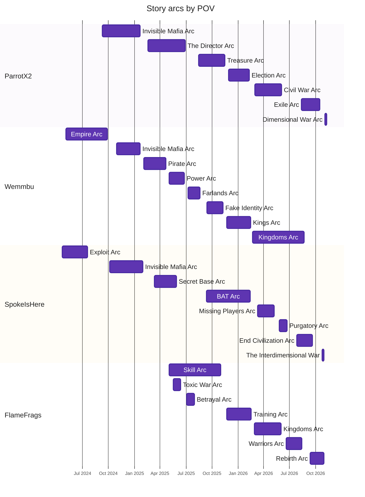
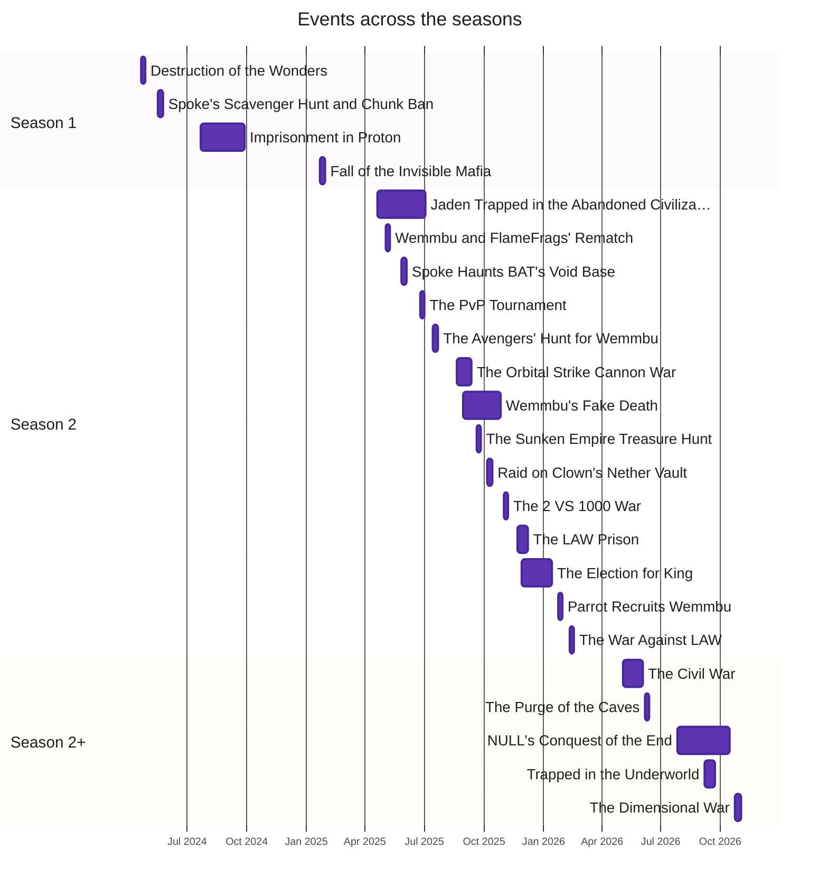
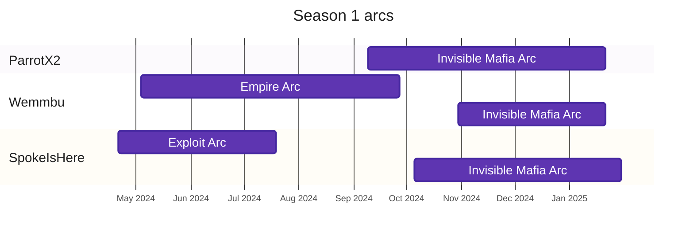
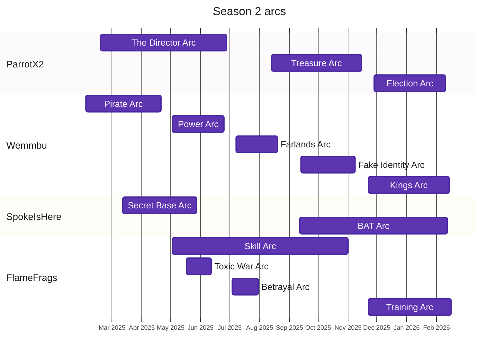
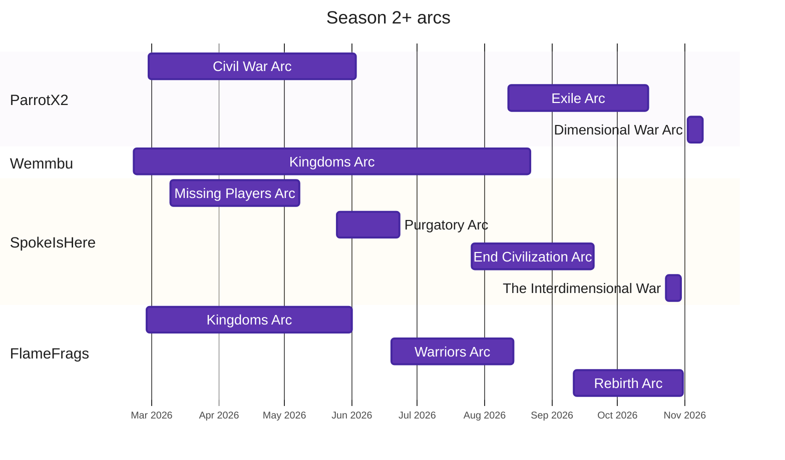

# Timeline

The four POVs run in parallel. Each bar spans an arc from its first to its last episode upload.

## Arcs by POV

## Multi-POV events

| Event | Started | Episodes | POVs |
|---|---|---|---|
| [Destruction of the Wonders](../events/destruction-of-the-wonders.md) | 2024-04-21 | [1](../episodes/season-1/001-how-to-destroy-the-unstable-smp.md), [2](../episodes/season-1/002-this-button-destroys-the-world.md) | SpokeIsHere, ParrotX2 |
| [Spoke's Scavenger Hunt and Chunk Ban](../events/spokes-scavenger-hunt-and-chunk-ban.md) | 2024-05-17 | [5](../episodes/season-1/005-i-uncovered-minecrafts-greatest-secret.md), [6](../episodes/season-1/006-its-impossible-to-catch-this-player.md) | ParrotX2, Wemmbu |
| [Imprisonment in Proton](../events/imprisonment-in-proton.md) | 2024-07-22 | [12](../episodes/season-1/012-its-impossible-to-find-this-player.md), [13](../episodes/season-1/013-unstable-smp-the-princezam-empire-war.md), [14](../episodes/season-1/014-how-i-escaped-minecrafts-largest-prison.md), [15](../episodes/season-1/015-escaping-proton-minecrafts-most-secure-prison.md), [17](../episodes/season-1/017-how-i-solved-minecrafts-largest-escape-room.md) | ParrotX2, Wemmbu |
| [Fall of the Invisible Mafia](../events/fall-of-the-invisible-mafia.md) | 2025-01-21 | [25](../episodes/season-1/025-unstable-smp-doomsday.md), [26](../episodes/season-1/026-unstable-smp-the-mafia.md), [27](../episodes/season-1/027-the-end-of-the-minecraft-mafia.md) | ParrotX2, Wemmbu, SpokeIsHere |
| [Jaden Trapped in the Abandoned Civilization](../events/jaden-trapped-in-the-abandoned-civilization.md) | 2025-04-21 | [36](../episodes/season-2/036-i-explored-an-abandoned-minecraft-civilization.md), [52](../episodes/season-2/052-solo-player-vs-minecraft-bounty-hunters.md) | Wemmbu, FlameFrags |
| [Wemmbu and FlameFrags' Rematch](../events/wemmbu-and-flamefrags-rematch.md) | 2025-05-03 | [38](../episodes/season-2/038-how-i-survived-the-unstable-smp.md), [39](../episodes/season-2/039-i-became-immortal-on-a-hardcore-minecraft-smp.md) | Wemmbu, FlameFrags |
| [Spoke Haunts BAT's Void Base](../events/spoke-haunts-bats-void-base.md) | 2025-05-28 | [44](../episodes/season-2/044-i-spent-100-days-trapped-in-a-minecraft-void-base.md), [45](../episodes/season-2/045-hunting-a-minecraft-player-who-doesnt-exist.md) | SpokeIsHere, ParrotX2 |
| [The PvP Tournament](../events/the-pvp-tournament.md) | 2025-06-25 | [49](../episodes/season-2/049-how-i-survived-a-hardcore-minecraft-tournament.md), [50](../episodes/season-2/050-dominating-minecrafts-deadliest-pvp-tournament.md) | Wemmbu, FlameFrags |
| [The Avengers' Hunt for Wemmbu](../events/the-avengers-hunt-for-wemmbu.md) | 2025-07-15 | [54](../episodes/season-2/054-i-explored-beyond-the-minecraft-fartherlands.md), [55](../episodes/season-2/055-i-got-revenge-on-the-unstable-smp.md) | Wemmbu, FlameFrags |
| [The Orbital Strike Cannon War](../events/the-orbital-strike-cannon-war.md) | 2025-08-20 | [64](../episodes/season-2/064-orbital-strike-cannon-vs-unstable-smp.md), [65](../episodes/season-2/065-minecraft-pro-vs-orbital-strike-cannon.md), [69](../episodes/season-2/069-i-became-a-bounty-hunter-on-the-unstable-smp.md) | Wemmbu, FlameFrags, SpokeIsHere |
| [Wemmbu's Fake Death](../events/wemmbus-fake-death.md) | 2025-08-30 | [66](../episodes/season-2/066-i-became-powerful-on-a-hardcore-minecraft-server.md), [68](../episodes/season-2/068-hunting-a-minecraft-player-who-went-missing.md), [70](../episodes/season-2/070-i-faked-my-death-on-a-hardcore-minecraft-smp.md), [73](../episodes/season-2/073-how-i-died-on-a-hardcore-minecraft-smp.md), [74](../episodes/season-2/074-hunting-a-player-who-faked-his-death.md), [75](../episodes/season-2/075-i-escaped-minecrafts-forgotten-dimension.md), [79](../episodes/season-2/079-this-player-stole-my-identity.md), [80](../episodes/season-2/080-100-players-vs-minecraft-combat-master.md), [81](../episodes/season-2/081-the-search-for-wemmbu.md), [82](../episodes/season-2/082-i-got-hunted-by-minecrafts-smartest-player.md), [83](../episodes/season-2/083-exposing-a-player-who-faked-his-death.md) | FlameFrags, Wemmbu, ParrotX2 |
| [The Sunken Empire Treasure Hunt](../events/the-sunken-empire-treasure-hunt.md) | 2025-09-20 | [71](../episodes/season-2/071-i-secretly-joined-my-enemys-minecraft-team.md), [72](../episodes/season-2/072-the-search-for-minecrafts-sunken-empire.md) | Wemmbu, ParrotX2 |
| [Raid on Clown's Nether Vault](../events/raid-on-clowns-nether-vault.md) | 2025-10-07 | [76](../episodes/season-2/076-i-infiltrated-minecrafts-deadliest-faction.md), [77](../episodes/season-2/077-the-hunt-for-minecrafts-deadliest-vault.md) | FlameFrags, ParrotX2 |
| [The 2 VS 1000 War](../events/the-2-vs-1000-war.md) | 2025-11-01 | [85](../episodes/season-2/085-2-vs-1000-player-minecraft-war.md), [86](../episodes/season-2/086-2-minecraft-pros-vs-1000-players.md) | FlameFrags, Wemmbu |
| [The LAW Prison](../events/the-law-prison.md) | 2025-11-22 | [90](../episodes/season-2/090-i-became-a-prisoner-on-the-unstable-smp.md), [93](../episodes/season-2/093-escaping-prison-on-the-unstable-smp.md), [94](../episodes/season-2/094-i-almost-got-banned-from-the-unstable-smp.md) | Wemmbu, SpokeIsHere |
| [The Election for King](../events/the-election-for-king.md) | 2025-11-28 | [91](../episodes/season-2/091-unstable-smp-the-first-king.md), [99](../episodes/season-2/099-i-ran-for-king-on-the-unstable-smp.md), [103](../episodes/season-2/103-i-survived-the-unstable-smp-purge.md) | ParrotX2 |
| [Parrot Recruits Wemmbu](../events/parrot-recruits-wemmbu.md) | 2026-01-24 | [106](../episodes/season-2/106-2-minecraft-pros-vs-1000-hunters.md), [107](../episodes/season-2/107-i-became-a-minecraft-killer.md) | ParrotX2, Wemmbu |
| [The War Against LAW](../events/the-war-against-law.md) | 2026-02-10 | [112](../episodes/season-2/112-i-became-king-of-the-unstable-smp.md), [113](../episodes/season-2/113-4-minecraft-pros-vs-2500-players.md), [114](../episodes/season-2/114-unstable-smp-the-law.md), [115](../episodes/season-2/115-2500-players-vs-minecraft-combat-master.md) | ParrotX2, SpokeIsHere, Wemmbu, FlameFrags |
| [The Civil War](../events/the-civil-war.md) | 2026-05-04 | [129](../episodes/season-2-plus/129-i-created-the-worlds-largest-minecraft-army.md), [132](../episodes/season-2-plus/132-i-joined-a-10-000-player-minecraft-army.md), [133](../episodes/season-2-plus/133-unstable-smp-civil-war.md), [134](../episodes/season-2-plus/134-1000-players-simulate-underground-civilization-in-minecraft.md), [136](../episodes/season-2-plus/136-i-went-to-war-on-a-hardcore-minecraft-smp.md), [137](../episodes/season-2-plus/137-1000-vs-1000-player-minecraft-civil-war.md), [138](../episodes/season-2-plus/138-unstable-smp-civil-war-finale.md) | ParrotX2, FlameFrags, Wemmbu |
| [The Purge of the Caves](../events/the-purge-of-the-caves.md) | 2026-06-06 | [139](../episodes/season-2-plus/139-1000-players-simulate-the-purge-in-minecraft.md), [140](../episodes/season-2-plus/140-i-became-the-strongest-on-the-unstable-smp.md) | Wemmbu, FlameFrags |
| [NULL's Conquest of the End](../events/nulls-conquest-of-the-end.md) | 2026-07-26 | [146](../episodes/season-2-plus/146-1000-players-build-end-civilization-in-hardcore-minecraft.md), [148](../episodes/season-2-plus/148-i-created-minecrafts-greatest-military.md), [154](../episodes/season-2-plus/154-how-i-saved-the-worlds-largest-minecraft-server.md), [155](../episodes/season-2-plus/155-i-created-minecrafts-greatest-empire.md), [158](../episodes/season-2-plus/158-1000-players-simulate-end-prison-in-minecraft.md) | SpokeIsHere, Wemmbu, ParrotX2 |
| [Trapped in the Underworld](../events/trapped-in-the-underworld.md) | 2026-09-06 | [151](../episodes/season-2-plus/151-1000-players-simulate-mining-prison-in-minecraft.md), [152](../episodes/season-2-plus/152-exploring-minecrafts-forgotten-dimension.md), [156](../episodes/season-2-plus/156-escaping-the-minecraft-underworld.md) | ParrotX2, SpokeIsHere |
| [The Dimensional War](../events/the-dimensional-war.md) | 2026-10-23 | [159](../episodes/season-2-plus/159-10-000-players-simulate-cold-war-in-minecraft.md), [160](../episodes/season-2-plus/160-10-000-vs-10-000-player-minecraft-war.md), [161](../episodes/season-2-plus/161-10-000-player-minecraft-war-nether-vs-overworld.md) | SpokeIsHere, FlameFrags, ParrotX2 |

## Season 1

27 episodes, 21 Apr 2024 – 30 Jan 2025. See the [Season 1 page](../episodes/season-1/index.md) for the full list.

## Season 2

88 episodes, 2 Feb 2025 – 16 Feb 2026. See the [Season 2 page](../episodes/season-2/index.md) for the full list.

## Season 2+

46 episodes, 21 Feb 2026 – 2 Nov 2026. See the [Season 2+ page](../episodes/season-2-plus/index.md) for the full list.

