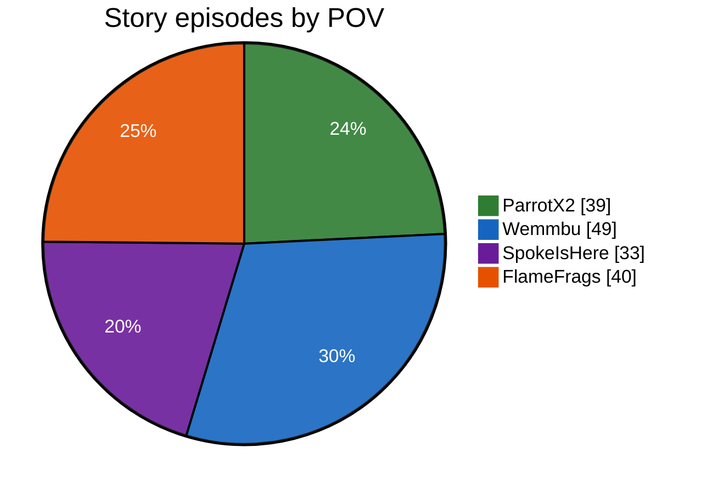

# Unstable Universe Notes

The Unstable Universe (also called the Unstable SMP) is a scripted Minecraft series told from the POVs of [ParrotX2](characters/parrotx2.md), [Wemmbu](characters/wemmbu.md), [SpokeIsHere](characters/spokeishere.md) and [FlameFrags](characters/flamefrags.md), with many other creators as recurring characters. Each creator uploads their own episodes, so one story event is often covered by several videos.

Every story episode has a detailed recap; every character, place, faction, item and event has its own page, cross-linked throughout. Start with an episode, a POV, or one of the overviews below.

-   :material-play-box-multiple:{ .lg .middle } **[Episodes](episodes/index.md)**

    ---

    161 story episodes across three seasons, plus 16 side videos.

-   :material-account-group:{ .lg .middle } **[Characters](characters/index.md)**

    ---

    57 bios with profiles, relationships and relationship diagrams.

-   :material-castle:{ .lg .middle } **[Places](places/index.md)** & **[Factions](factions/index.md)**

    ---

    37 places and 18 factions, each with its history.

-   :material-sword-cross:{ .lg .middle } **[Events](events/index.md)** & **[Arcs](arcs/index.md)**

    ---

    23 multi-POV events with timelines, and 27 story arcs.

-   :material-cog:{ .lg .middle } **[Items & mechanics](mechanics/index.md)**

    ---

    26 weapons, machines and exploits, and every episode they appear in.

-   :material-chart-timeline-variant:{ .lg .middle } **[Explore](explore/timeline.md)**

    ---

    The [timeline](explore/timeline.md), [statistics](explore/statistics.md) and an interactive [link graph](explore/graph.md).

## The four POVs

-   { .uu-card-img loading=lazy }

    **[ParrotX2](characters/parrotx2.md)** <small>39 POV episodes · 27 Apr 2024 – 2 Nov 2026</small>

-   { .uu-card-img loading=lazy }

    **[Wemmbu](characters/wemmbu.md)** <small>49 POV episodes · 4 May 2024 – 19 Sep 2026</small>

-   { .uu-card-img loading=lazy }

    **[SpokeIsHere](characters/spokeishere.md)** <small>33 POV episodes · 21 Apr 2024 – 23 Oct 2026</small>

-   { .uu-card-img loading=lazy }

    **[FlameFrags](characters/flamefrags.md)** <small>40 POV episodes · 3 May 2025 – 31 Oct 2026</small>

## Seasons

| Season | Episodes | Uploaded |
|---|---|---|
| [Season 1](episodes/season-1/index.md) | 27 | 21 Apr 2024 – 30 Jan 2025 |
| [Season 2](episodes/season-2/index.md) | 88 | 2 Feb 2025 – 16 Feb 2026 |
| [Season 2+](episodes/season-2-plus/index.md) | 46 | 21 Feb 2026 – 2 Nov 2026 |

## Latest episodes

-   { .uu-card-thumb loading=lazy }

    **[Ep. 161 · 10,000 Player Minecraft War: Nether VS Overworld](episodes/season-2-plus/161-10-000-player-minecraft-war-nether-vs-overworld.md)** <small>ParrotX2 · 2 Nov 2026</small>

-   { .uu-card-thumb loading=lazy }

    **[Ep. 160 · 10,000 VS 10,000 Player Minecraft War](episodes/season-2-plus/160-10-000-vs-10-000-player-minecraft-war.md)** <small>FlameFrags · 31 Oct 2026</small>

-   { .uu-card-thumb loading=lazy }

    **[Ep. 159 · 10,000 Players Simulate COLD WAR in Minecraft](episodes/season-2-plus/159-10-000-players-simulate-cold-war-in-minecraft.md)** <small>SpokeIsHere · 23 Oct 2026</small>

-   { .uu-card-thumb loading=lazy }

    **[Ep. 158 · 1000 Players Simulate End Prison in Minecraft](episodes/season-2-plus/158-1000-players-simulate-end-prison-in-minecraft.md)** <small>ParrotX2 · 15 Oct 2026</small>

-   { .uu-card-thumb loading=lazy }

    **[Ep. 157 · Escaping Terminus: The Deadliest Minecraft Prison](episodes/season-2-plus/157-escaping-terminus-the-deadliest-minecraft-prison.md)** <small>FlameFrags · 6 Oct 2026</small>

-   { .uu-card-thumb loading=lazy }

    **[Ep. 156 · Escaping the Minecraft Underworld](episodes/season-2-plus/156-escaping-the-minecraft-underworld.md)** <small>ParrotX2 · 22 Sep 2026</small>

!!! note "Sources"
    Recaps are written in my own words from the [Unstable Universe Wiki](https://unstable-universe-mc.fandom.com/wiki/Episode_Order) (CC BY-SA). Thumbnails are loaded from YouTube and character/place images from the wiki; see [About](about.md).
